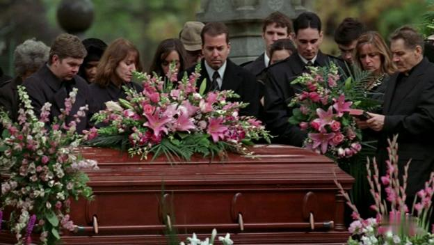

# The Unseen Mourner

*Originally published 2006-03-07 on the Blogspot site*

In episode 12 of Prison Break, LJ sneaks out of the hospital to attend his mother's funeral.   As the camera pans across the scene, a group of mourners is seen at the grave site.  Unseen, off camera to the left, is Carol, the mourner.  Also on the cutting room floor, is Carol and her Blazer driving from the cemetery in the funeral procession.
