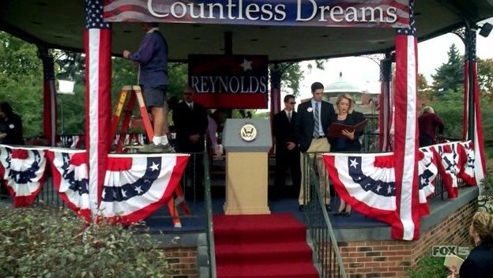
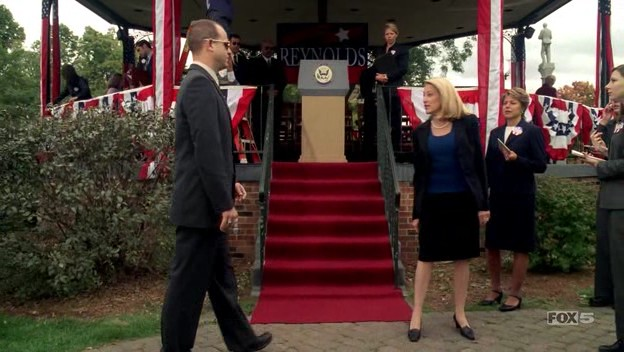
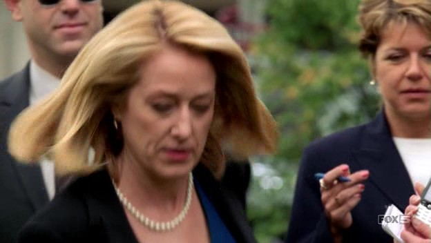
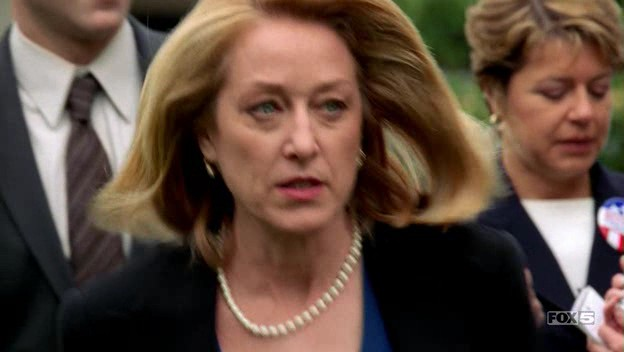

# First appearance on Prison Break

*Originally published 2006-03-07 on the Blogspot site*

**
11/07/05,  27 minutes into episode 10 of Prison Break, Carol makes her debut appearance in her breakout performance as "Vice Presidential Aide".  Carol is visible on screen in three shots in this scene.  As the camera slowly pans across the area, and moves in on the gazebo as Caroline Reynolds practices her speech, look in the lower right corner of the screen, just to the right of the steps leading up to the gazebo.

As agent Kellerman comes to talk with Reynolds, Carol is clearly visible just behind and to the right of the Vice President.

And finally, as Vice President Reynolds goes off to talk with Kellerman, she turns and motions to her aide (Carol), to "wait there".

Just look at the impatience and irritation in Carol's expression, as the Vice President walks towards the camera.  Brilliant!

---

## Comments (1)

*Reader comments, as captured from the Blogspot site.*

**Anonymous** — *2006-03-16*

> love the manicure too!
