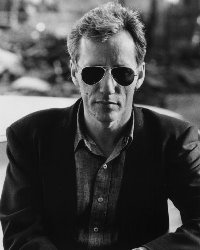

# Lunch with James Woods

*Originally published 2006-03-07 on the Blogspot site*

It was August 2003 in Las Vegas.  While waiting to meet friends at the Bellagio, Carol, Mark and James were having lunch in the Olives restaurant.  James had to leave for a prior engagement, but a wonderful time was had by all.  Perhaps Carol and James will collaborate on some future project.

---

## Comments (2)

*Reader comments, as captured from the Blogspot site.*

**Anonymous** — *2006-03-27*

> no way... you really had lunch with James Woods????  Did he ask you for your autograph?? He must have sensed your upcoming stardom! :)

**Carol's Biggest Fan** — *2006-03-28*

> It depends on your definition of the word "with".  I am leaning towards this definition: "in the company of; alongside, along side of; close to; near to."  We were definitely having lunch in the same restaurant, at the same time!  James is a busy man, so perhaps he may not recall the exact encounter, however memorable it may have been.
