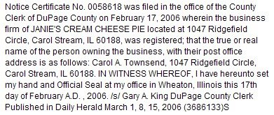

# Janie's Cream Cheese Pie

*Originally published 2006-03-08 on the Blogspot site*

After taking a small business class last year, Carol began to form a plan for selling Cheesecakes (or cheese pies) using her mother (Janie)'s recipe.  After having tested and perfected the process (using many friends and family as willing test subjects), Carol took the step of forming a business.  The notice above (which appeared in the DuPage Daily Herald) announces Carol's arrival into the world of small business!  Now all that remains to be worked out is Health Department inspection, liability insurance, mass production and shipping logistics.  Looking for a special dessert for your next birthday, wedding, baptism, bar mitzvah, holiday, surgery, or briss?  Cheese Pie anyone?  Place your orders by e-mailing [janiescreamcheesepie@yahoo.com](mailto:janiescreamcheesepie@yahoo.com) today!
