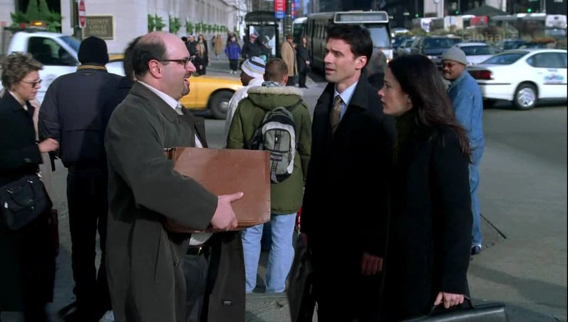
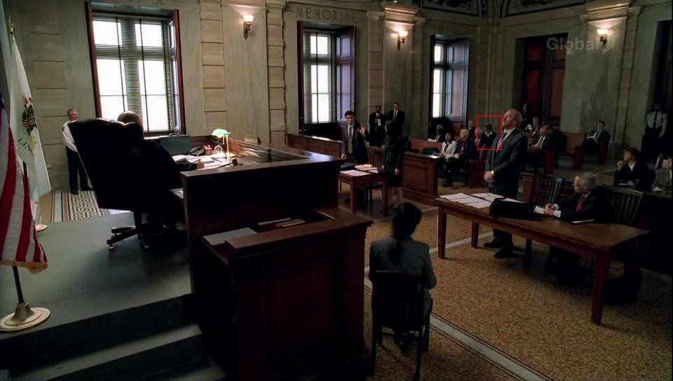

# Prison Break Update - Episode 14

*Originally published 2006-03-22 on the Blogspot site*

You may have spotted Carol in Monday's Prison Break (3/21, episode 14, 15:35 into the episode), if you get FOX in HD (16:9 Wide-screen-- I do not think she was visible in the standard 4:3 version).  In this scene where Nick and Veronica are trying to convince Nick's law school buddy to get them a hearing, you can catch a glimpse of Carol for .83 seconds.  See the shot above, far left of the screen.  What a performance!

UPDATE: Exhumation Order?  See the video clip by below.  Don't blink!

**
(Hint: look at the very left of the screen at the very end of the clip.)

But wait-- there's more!  Later, (25:28 into the episode) in the courtroom where Nick and Veronica are making their appeal... Who's that blur?   You be the judge...

(click on the picture to see a larger version, with Carol's blob highlighted)
