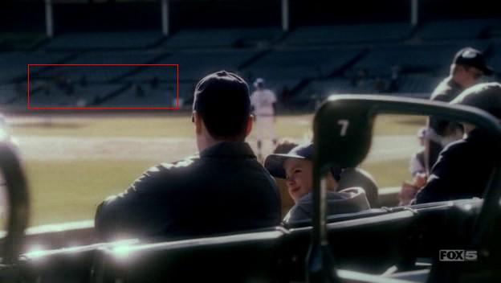

# Prison Break Update - Episode 15

*Originally published 2006-03-28 on the Blogspot site*

Episode 15 aired yesterday, which had two potential appearances.  Alas, Carol was visible in neither of them.  In the Wrigley Field scene, Carol was somewhere in the crowd of people crossing the street, as well as one of the unidentifiable blurry people across the field from Young Lincoln and Dad (dressed in brown with long brown hair).  Check out the red section in the shot below.  Do you see Carol?

In the press conference where the VP was lamenting over the exhumation of her brother, Carol was one of the reporters off camera to the left.

According to the previews for next week's flashback episode, several of Carol's upcoming scenes will be in it.  Watch for Carol as:  The prosecuting attorney at Lincoln's trial, a patron in a restaurant with Michael and Veronica, and a pedestrian outside the window in a restaurant scene.  Oh, the suspense!
