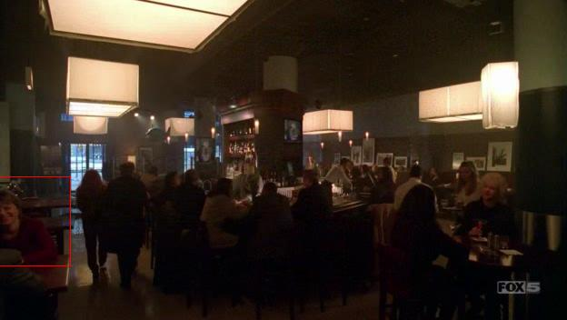
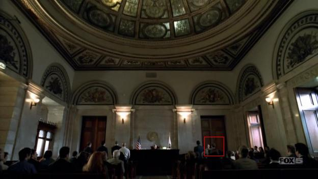
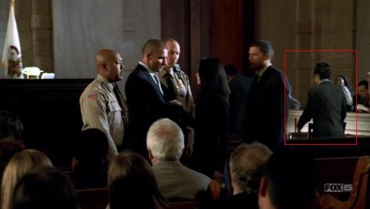
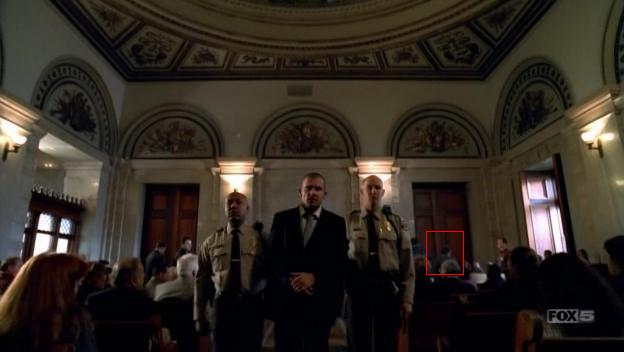
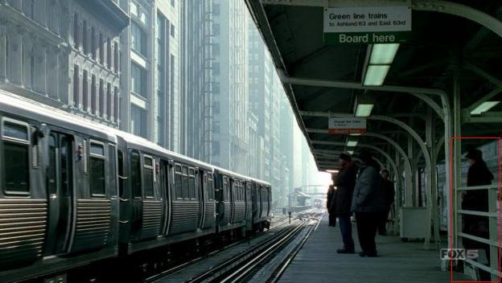
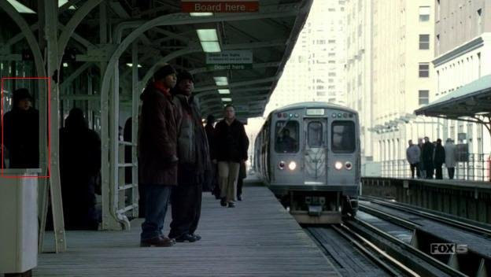

# Prison Break Trifecta

*Originally published 2006-04-03 on the Blogspot site*

Episode 16 aired tonight, and Carol was featured in an amazing three scenes!  At 1:43 into the episode (widescreen version), you can catch Carol laughing just at the left edge of the screen as the waitress brings drinks to their table.  Oddly enough, Carol was also one of the pedestrians walking back and forth outside the restaurant window, but she is not visible in any of those shots.  Wait-- how can she be sitting in the restaurant AND walking outside the window?!  Its unnatural!   See the still below (click the pictures for a larger view), or the clip below.
**

Next, at 19:52 into the episode, Carol is featured as one of the Prosecuting Attorneys in Lincoln's Trial scene. (So, when you think about it, we have Carol to thank for the fact that Lincoln was sent to prison and scheduled for execution.  There wouldn't be a series otherwise!) In the standard version, you can only glimpse her from the back (right side of the screen, where the prosecuting attorneys are).  But in the widescreen version, you can also see her packing up her briefcase as Veronica and Lincoln share a moment.  See the three stills below, or the clip here.

**

And finally, at 21:42 into the episode, on the "L" platform, Carol is seen twice, from different angles.  As the scene starts, she is coming up the stairs on the right of the screen (widescreen only).  The camera angle then reverses, and she is now on the left, coming up the stairs and walking behind "C-Note" and his brother-in-law.   Dig the funky hat!  See the two stills below, or the clip below.

**

All in all, a great episode for Carol-spotting!  You could almost make a drinking game out of it-- if you weren't really intending to get drunk.  Stay tuned for the coming episodes where Carol shows her versatility as a Secret Service Agent, and once more reprises her role (perhaps visibly, this time) as a Reporter at a Vice Presidential news conference!
