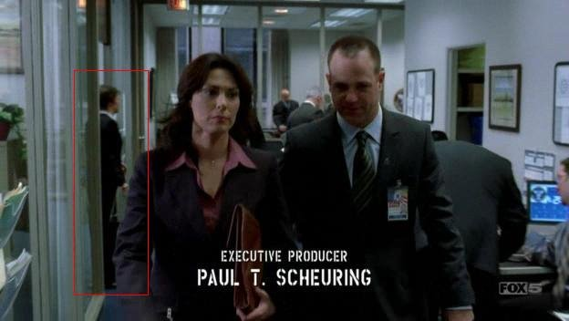
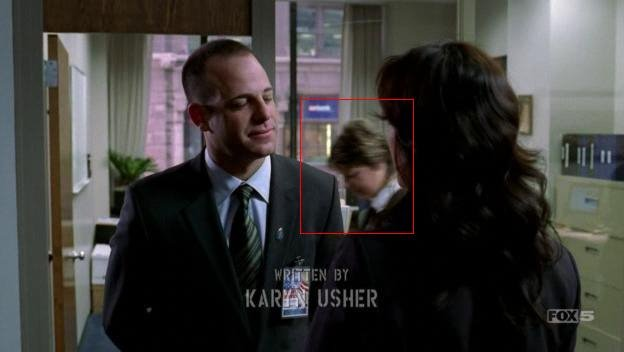
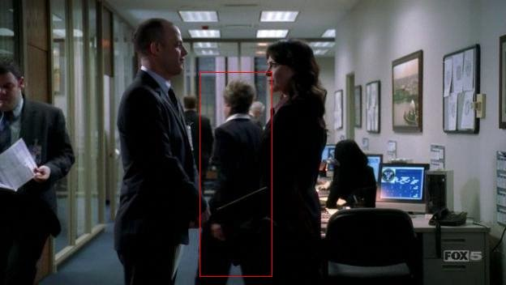

# Agent Betsy Ross

*Originally published 2006-04-10 on the Blogspot site*

Prison Break, episode 17, April 10:  Agent Betsy Ross (the name that was on Carol's badge for this scene), must be the hardest working agent in the service! In the scene at the Secret Service Office with Kellerman and Brinker (the woman from "the Company"; who incidentally played Ensign Ro Laren on ST:TNG, and Admiral Cain on Battlestar Galactica; but I digress...) you can glimpse Agent Ross an amazing THREE times!  You can view the full scene in the window below.

**
Click the pictures below for larger views.

At the beginning of this scene, as Kellerman and Brinker are discussing the man in the picture and Kellerman asks "How is he involved in this situation?", Agent Ross (Carol) exits an office on the left just as they pass by, and walks down the aisle behind them away from the camera.

A few moments later, as Kellerman questions Brinker about using the son of a company man as their "patsy", Agent Ross walks behind them, (a full screen traversal!) right to left.

And finally, when Brinker tells Kellerman that his job is "to be seen, not to be heard", Agent Ross again passes behind them and walks away from the camera.

Agent Ross must be exhausted by the end of the day!

Two other scenes in this episode were potentials for Carol-spotting, but did not pan out.  In the diner scene with Dr. Tancredi and friend, Carol was a pedestrian outside the diner window, on the *other side of the street!*  In the scene where LJ is being arrested, Carol was one of the neighborhood onlookers (of which, none were visible).  Ah well, you can't win them all!

---

## Comments (1)

*Reader comments, as captured from the Blogspot site.*

**Anonymous** — *2006-04-12*

> How great is she????  When "Betsy" really becomes famous, I want her to pay off my mortgage.
>
> Love, Shirley
