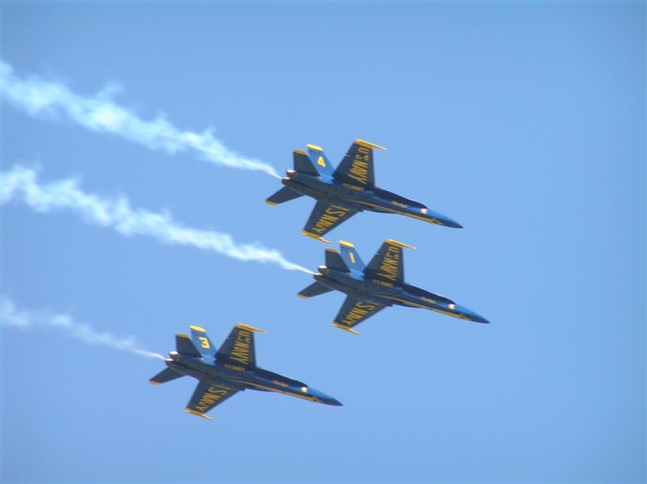

# Thunder Over Louisville

*Originally published 2006-04-24 on the Blogspot site*

Greetings All,
Carol and I visited Louisville, KY over the weekend for the annual [Thunder Over Louisville](http://thunderoverlouisville.org) show.  Every year, the weekend before the Kentucky Derby, they conduct a huge airshow and the largest fireworks display in North America (and the second largest in the world).  We went for the first time last year, and the weather was awful-- cold, raining, windy-- and yet, it was still an incredible show!

This year, the weather was beautiful, 75 and sunny, and the show was fantastic.  The Navy Blue Angels were the main attraction at the air show (always impressive), and the fireworks were unbelieveable.  Pictures and video can't do it justice-- you just have to see it to believe it.  If you want to check out some pictures from the airshow, you can view them on my [Shutterfly page here](http://share.shutterfly.com/action/welcome?sid=8AYs3LJo4csmM4).
