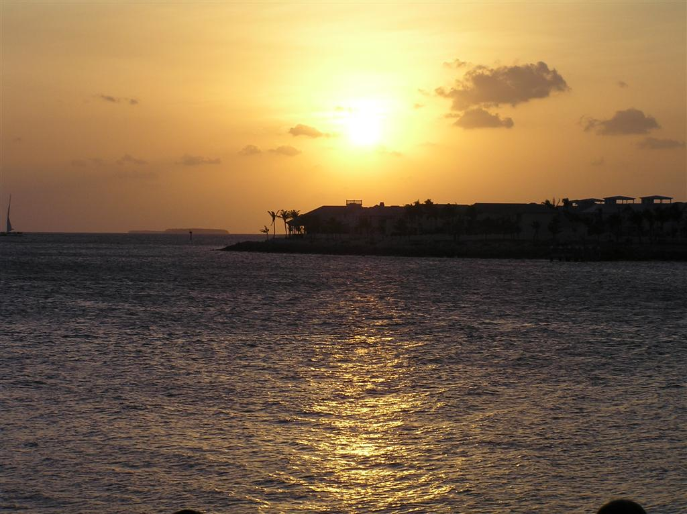
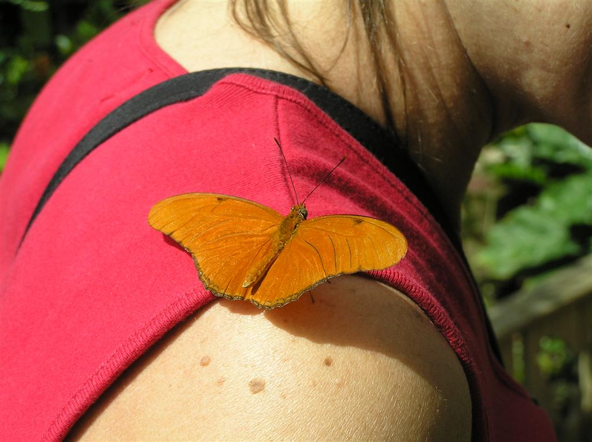

# Fun in the Sun

*Originally published 2006-05-01 on the Blogspot site*

Last weekend, Carol and I took a break from cool and rainy Chicago to visit the sun and sand in Key West with some friends.  A great time was had by all!  Carol was especially pleased with the [Key West Butterfly Conservatory](http://www.keywestbutterfly.com/). The variety of colors and species was amazing.  As you can see, Carol made some new friends.

We did the required tourist activities... snorkel cruise, visited the southernmost point in the Continental US, visited mile-marker 0.  We stayed at the lovely [Avalon Bed & Breakfast](http://www.avalonbnb.com/).  It was a great little place on the quiet end of Duval Street.  You can see all of our pictures on [Shutterfly](http://share.shutterfly.com/action/welcome?sid=8AYs3LJo4csmNP).
