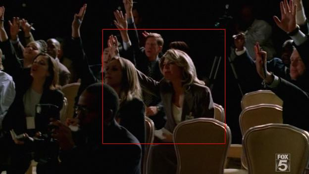
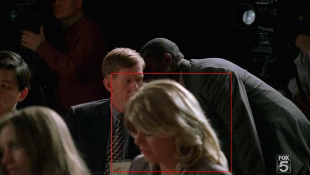
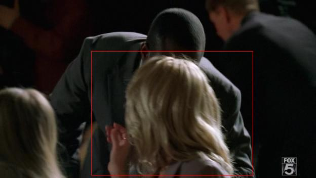
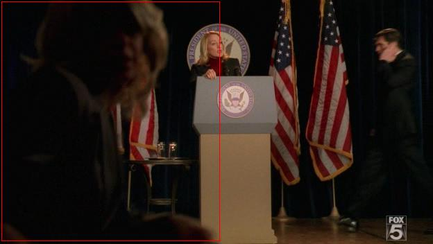

# Don't Drink The Water! (Spoilers)

*Originally published 2006-05-15 on the Blogspot site*

Yikes!  What a nail-biter!  Two main characters killed, one severed hand, poisoned water, and a psychopath on a bicycle!  Not to mention, the stunning debut of Carol's blonde alter-ego, "Babs".  Excellent!  Not only was Carol (Babs) prominently featured in the press conference, but also very briefly in the flashback to Lincoln's trial.

**

Who's that blonde bombshell in the third row?  The new CNN newsbabe?  Look at the determined way that she vies for the vice-president's attention; "Madame Vice-President!  Madame Vice-President!"  Babs is clearly visible several times in this scene, as the camera scans the group as the reporters ask their questions.

When the man comes into the room and starts whispering to the reporters, Babs turns around to see what the commotion is.  The man whispers something to her, and she hurriedly gets up to leave the room, crossing right in front of the camera.

