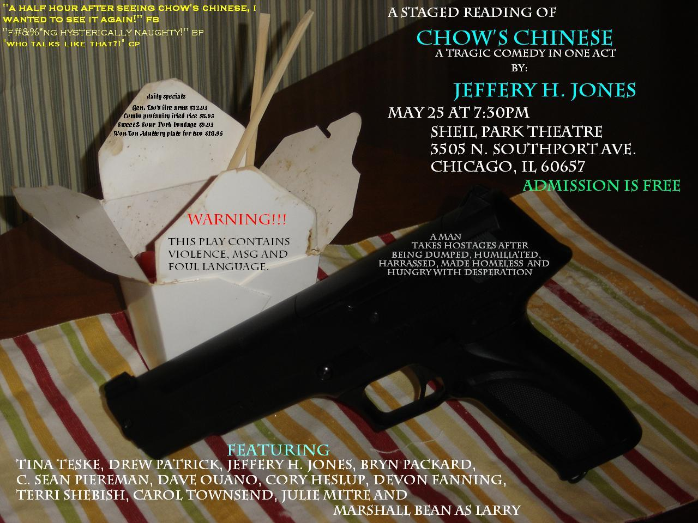

# Life After Prison Break: Chow's Chinese

*Originally published 2006-05-27 on the Blogspot site*

So, what has our starlet been up to since Prison Break has wrapped in Chicago (and will be [moving to Dallas](http://www.darkhorizons.com/news06/060516b.php) for filming next season)?  Carol recently auditioned for, was cast, and appeared in, a staged reading of "Chow's Chinese"; which was written by Jeffery Jones, who was also one of the background actors on Prison Break.

What?!  Carol appeared (past tense) in a stage show, and it wasn't reported here?!  No announcement?  We didn't send out emails and flyers, and flock to the show to see Carol's first appearance live and on stage?!  (Well-- first appearance since playing Tigger in the seventh grade).  I am ashamed to report-- yes, that is the case.

On May 25th, at the Sheil Park Theater in Chicago, Carol made her stage debut.  Unfortunately, her first appearance coincided with an out-of-town commitment which I could not change, and so I was forced to miss it as well.  In Carol's understated estimation, "it was good."  They laughed (the audience), they cried (those that missed it), and they bowed (the actors).

I am sure this will not be the last opportunity to see Carol in action.   Now that Carol has basked in the glory of the stage lights, felt the exhilaration of taking her first bow on stage, and is willing to allow her fans to "see her in action", I promise we will be more forthcoming with information in the future.
