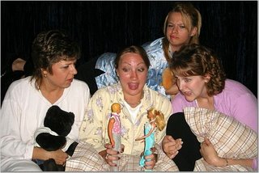

# The Birds and the Bees

*Originally published 2006-08-07 on the Blogspot site*

August 7, 2006

FOR IMMEDIATE RELEASE

New West Suburban Theater Company’s First Production Takes You Back to Your Youth

The Soapbox Theatre Company’s first production, Movin’ Right Along, opens August 18th. The production is a one of a kind variety show which features scenes varying from original works to those of Monty Python fame. One of the vignettes gives the audience the chance to relive a typical young girls’ slumber party. Cast members Carol Townsend, Nicole Warren, Julie Bayer and Christine Wortham take spectators on a trip back in time - landing directly in the middle of a “birds and the bees” discussion between four friends in their sleeping bags. This nostalgic piece is just one of the many laugh out loud sketches that make this production a must-see.

(L-R: Carol Townsend, Nicole Warren, Julie Bayer & Christine Wortham)

Movin’ Right Along runs August 18th through the 27th, with shows Friday and Saturday evenings at 8:00 p.m. and Sundays at 3:00 p.m. The productions will be held at First Street Playhouse’s Fiore Theater at 160 S. Water Street in Batavia. Tickets are on sale now at [www.soapboxtheatre.com](http://www.soapboxtheatre.com).
