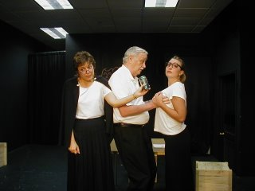
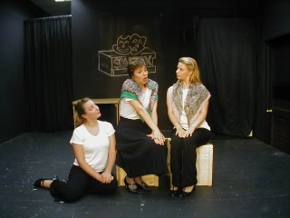

# Three to go...

*Originally published 2006-08-21 on the Blogspot site*

We're half-way through the production run, meaning you only have three more opportunities to catch the show before it disappears forever.  I've seen it twice, and as with bowling, the second was even better than the first.  This will be your one opportunity to see Carol in her debut performance!  Imagine the stories you will be able to tell your grandchildren someday...

"Jimmy, did I ever tell you about the time when I saw Carol Townsend on stage, back in 2006, before she was famous?  It was her first show."
"Really, grandma?!  Wow!  Did you get her autograph?"
"I did.  But I sold it last year on eBay to pay for my hip surgery."

Don't miss out on this opportunity of a lifetime!  You can view some production photos of the show [here](http://soapbox.shutterfly.com/action/), or clicking the photos above.  Enjoy!

---

## Comments (1)

*Reader comments, as captured from the Blogspot site.*

**Anonymous** — *2006-10-04*

> *How* did that guy get away with fondling that girl's boobs?  He should be teaching our sexual harrassment course!  He's obviously got a few tricks.
