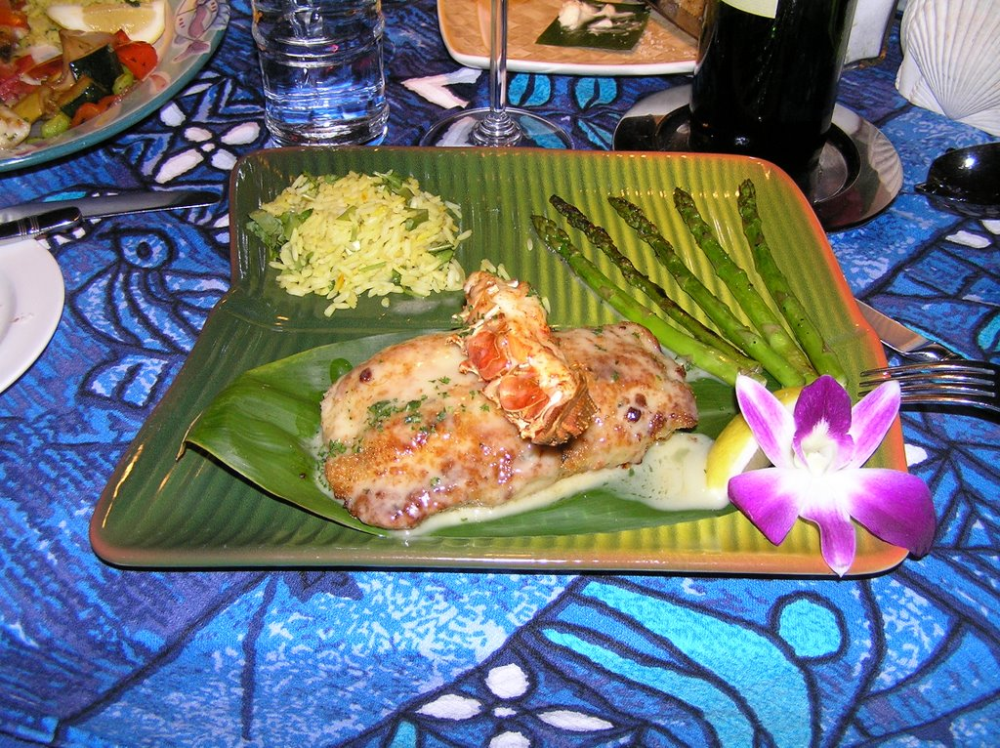

# Helicopters, Firetrucks, and Ambulances... oh my!

*Originally published 2006-11-18 on the Blogspot site*

Carol has had a busy week-- starting with another scene for ER last weekend.  It was a night  time scene in a west-side neighborhood, with helicopters, firetrucks, and... well, you get it.   Watch for Carol's Blazer (vehicle, not clothing), as it may have a more prominent role than Carol in this scene.

The Wizard opened last night to a nearly full house.  Unfortunately, I was unable to see the opening show, but I'll be sure to give an update after I see it on Sunday.  More press coverage on the [Suburban Life](http://www.libertysuburban.com/story.php?pub=10&sid=70713) site.

I'm still working through our Hawaii pictures.  In the meantime, I'll leave you with this picture from [Mama's Fish House](http://www.mamasfishhouse.com/dining.html).

Aren't we just sickeningly cute in our matching Hilo Hattie wear?  And SH, as a tribute to you, I also offer this picture.  It was delicious!

---

## Comments (3)

*Reader comments, as captured from the Blogspot site.*

**Anonymous** — *2006-11-19*

> Wow, great presentation on the food!!!!  Was that at the same place as the matching outfit picture?
>
> SH

**Carol's Biggest Fan** — *2006-11-19*

> Indeed, it was!  I believe it was the crab-stuffed Mahimahi.  It tasted as good as it looked.

**Anonymous** — *2006-11-19*

> Carol,
> Didn't you have enough of the matching outfits when we were kids?
> lol  It's "cute".
