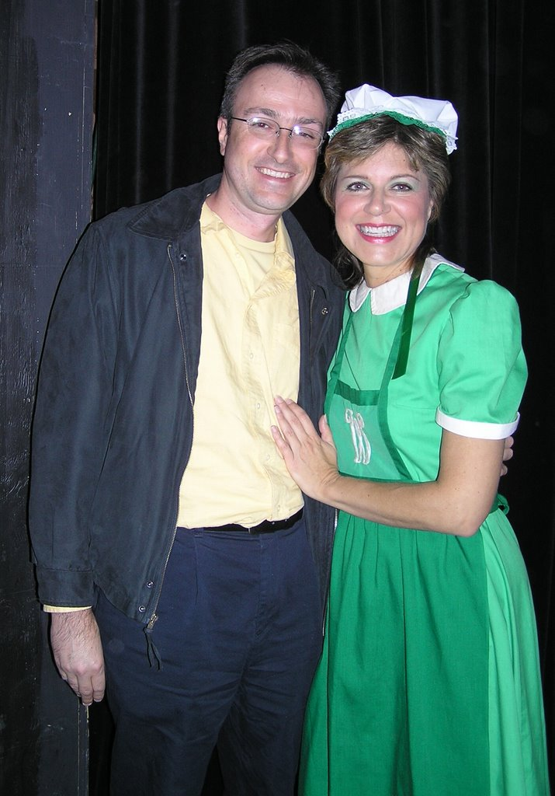
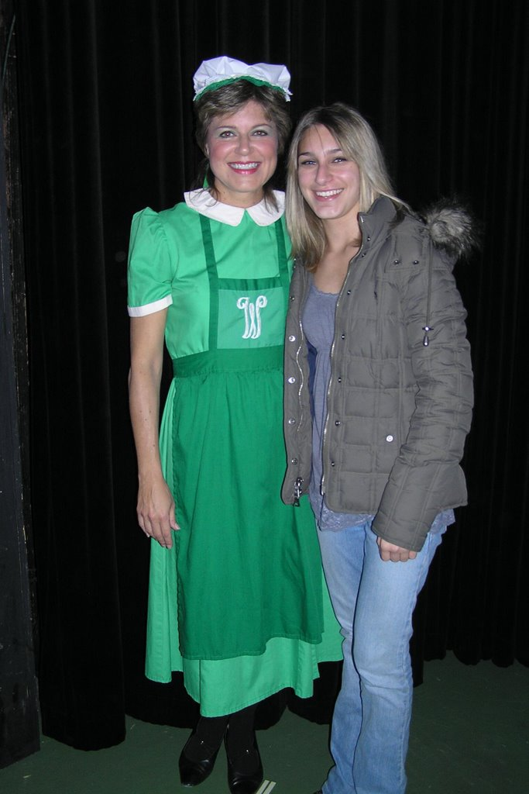

# To The Wizard!

*Originally published 2006-11-19 on the Blogspot site*

"A fabulously entertaining rendition of the Wizard of Oz!", said one anonymous reviewer.   Craig Gustafson as the Cowardly Lion was channeling Bert Lahr, and Emma Pauer was too cute for words as Toto.  Special effects were quite good for this community theater production.

Carol Townsend was a standout performer as Jitterbug, Winkie and Ozian.  Carol's Ozian #15 was energetic and compelling.  Her enthusiastic buffing of Tin Man was like no other!  When the Wicked Witch appeared over Oz demanding Dorothy's surrender, Carol's switch from euphoric to distressed Ozian culminated in her delivery of the line "To the Wizard!"

Carol's Jitterbug #14 was chilling, thrilling, and full of energy.  Spirit fingers and jazz hands, and just a hint of The Thriller were evidenced during this spooky dance number, which was inexplicably cut from the original movie production.

Not to be overlooked was Carol's memorable performance as Winkie #6.  Menacing and malevolent, Carol's portrayal of the tortured Witch's guard was provocative and moving.

The costumes were gorgeous, and Carol's quick costume changes were executed with expeditious precision.  After the show, two of Carol's biggest fans were lucky enough to corner her for a quick picture.

So far, shows have been nearly sold-out.  Don't miss your chance to see this family classic before it disappears!  A special children's matinee has been added on December 2nd at 3pm.  Check the [Wheaton Drama](http://www.wheatondrama.org/) site for details.

---

## Comments (2)

*Reader comments, as captured from the Blogspot site.*

**Anonymous** — *2006-11-19*

> Great show.  We're proud of you! See you on Broadway soon?

**Anonymous** — *2006-11-19*

> Remember to call in and vote for me when I'm on Dancing with the Stars!
