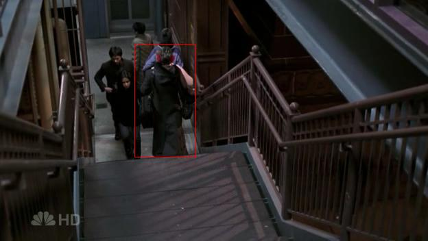
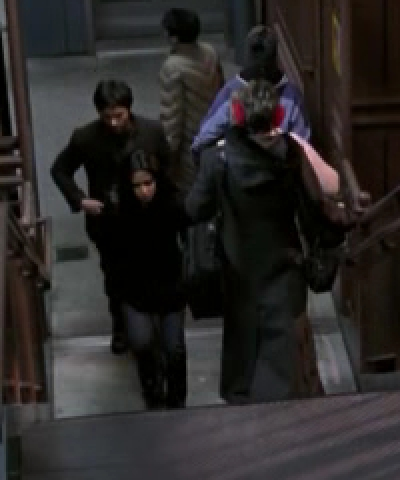

# The Lady in Red

*Originally published 2006-12-01 on the Blogspot site*

Last night marked Carol's triumphant return to television with her debut on ER!  38:27 into the episode, Carol makes her appearance as Neela and Gates are walking up the stairs to the L platform.  She is walking down the stairs towards them, so we only see her back (distinguishable by her red earmuffs).  In case you missed it, here is a close-up.

Screen time is only 8 seconds, but on network TV, that's an eternity!  You can view the whole scene below.

**
There is another scene which we thought would be in this episode, with Carol's Blazer.  That scene is in the Kovac/Ames storyline, so it must be in an upcoming episode.  Stay tuned!
