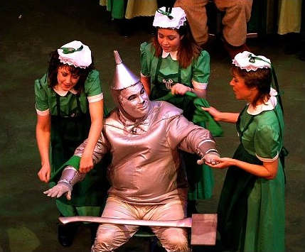
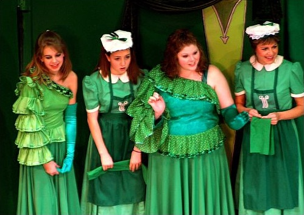
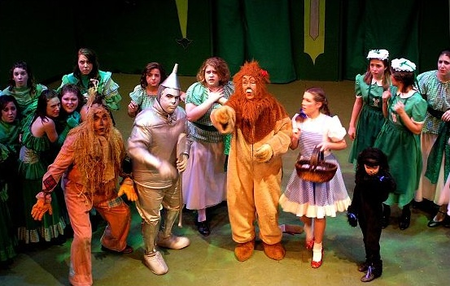
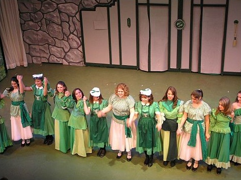

# Wizard of Oz Final Week

*Originally published 2006-12-08 on the Blogspot site*

This is the last week for Wizard of Oz at Wheaton Drama. Only three shows remain. If you haven't seen it yet, here are some more pictures of our favorite Ozian/Jitterbug/Winkie, in case you still need justification to get a last minute ticket (click pictures for larger view):

Carol (right) buffing the Tinman

> **[missing image]** `ozian2.jpg`  
> original: http://2.bp.blogspot.com/_xgOEfuf9tiQ/RXkGsBl2UhI/AAAAAAAAAAU/FHCIRIOz0VU/s200/ozian2.jpg

> **[missing image]** `ozian3.jpg`  
> original: http://3.bp.blogspot.com/_xgOEfuf9tiQ/RXkGwRl2UiI/AAAAAAAAAAc/ydOpiMGkaR0/s200/ozian3.jpg

Carol in the Merry Old Land of Oz

Carol (right side, facing rear) reacting to the Wicked Witch's demand to Surrender Dorothy

> **[missing image]** `jitterbug1.jpg`  
> original: http://3.bp.blogspot.com/_xgOEfuf9tiQ/RXkHARl2UmI/AAAAAAAAAA8/V6186ViImaM/s200/jitterbug1.jpg

Carol as one of the faceless Jitterbugs

> **[missing image]** `winkie1.jpg`  
> original: http://4.bp.blogspot.com/_xgOEfuf9tiQ/RXkHDhl2UnI/AAAAAAAAABE/8JvgQNjzeB8/s200/winkie1.jpg

Carol as the menacing Winkie (on left, behind Scarecrow)

Taking a bow (Carol is 2nd from left, the Ozian in green dress with white hat)

All these pictures are courtesy of Trish Robb.  You can view her entire [Shutterfly collection here](http://share.shutterfly.com/action/welcome?sid=8AZNGLJw1btWIL).

In other news, it appears that Carol's remaining scene in ER will not be for a while, or is on the cutting room floor.  The storyline is still developing, so we'll keep watch and update the blog if there is any further development.

Carol has already started rehearsals for her upcoming show, [The Memory of Water](http://www.groveplayers.org/seasons/20062007/memoryofwater/memoryofwater.htm).  TMOW is an English "dramedy", revolving around three dysfunctional sisters who come together to arrange their mother's funeral.  Carol will once again make use of her Mary Poppins/Julie Andrews-inspired British accent, not seen since its brief use during "The Mouse" in Movin' Right Along.  Supercalifragilisticexpialidocious!
