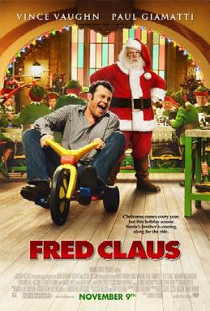

# Fred Claus

*Originally published 2007-01-08 on the Blogspot site*

A belated Merry Christmas and Happy New Year to all!  Christmas may be over, but there were Santas and Carolers in Chicago on Michigan Avenue this weekend.  I mentioned several posts ago that Carol had been asked to work as an extra (or, as many prefer: background actor) for the upcoming Christmas movie, Fred Claus.  Since I had such a great time in my last (or first) film appearance ("The Strip", back in August), I decided to give it another try.

I sent my picture to Joan Philo Casting, and what do you know... they called me! In fact, they wanted me quite badly for a scene with a bunch of "nicely dressed businessmen", but unfortunately, I wouldn't have been able to work with Carol if I had taken that job-- plus, I don't have a business suit that actually fits me any more (maybe time to lose a few holiday pounds!), and they were looking for men in suits.  Thus, I had to decline the special project.  Instead, I got to work the same days that Carol was scheduled for, and we spent two days downtown, doing our best imitations of upscale Michigan Avenue shoppers.

Day 1:  We started the first day in front of the Historic Water Tower, walking back and forth as the camera across the street shot establishing shots.   Then we were unceremoniously moved to a corner even farther away in front of Water Tower Place, where we had to stand in the biting wind, and are quite likely not visible at all-- not fun!  Our next assignment was a bit better, in that we moved to the opposite corner where Vince (we're on a first name basis now) was shooting a scene with several Santas.  (Oddly enough, you can see a number of pictures of  this scene being shot on this [Polish News Site](http://www.eastnews.com.pl/news/temat.php?temat=00127097).)  We spent an hour or so walking back and forth around Vince, as he worked the crowd of busy shoppers for Christmas donations.  We just might be visible in this scene, as we passed back and forth behind Vince and in front of the camera a number of times.  After lunch, we ended that day in another grunt scene, where we basically stood across the street from where Vince was shooting, and acted as a human barrier to keep passerby from crossing the street.  Twelve hours total, end of Day 1.

Day 2:  Our call time was 5am (as was Day 1).  They had to finish part of a scene that they started filming the day before, so we got to sit inside while they took some of the group to finish that scene.  Long story short, we sat around for over six hours!  (But, at least we were inside, and could catch up on our sleep.)  Just as they brought lunch in, they told us we could grab lunch, and then they would use us--  but, things change quickly, and because the sun was right, they needed us right now.  Hurry up and wait-- that is the life of a background actor.  We dropped our sandwiches, hurried down to the Wrigley Building where this scene was being shot, got positioned and received our instructions (Carol and I were to just stand and "mingle").  And then-- the sun wasn't right.  So, they had to reposition the cameras, and shoot from the opposite angle (now facing away from us-- so we're now BEHIND the cameras).  So, we got to stand around for another two hours while they shot various parts of this scene.  Finally, at about 2:00, they turned the cameras around to shoot back in our direction, and we got to reprise our roles as "upscale Michigan Avenue shoppers".  So, after 11.5 hours and no lunch, our second day came to an end.

Two very long days standing around in the Chicago cold is enough for me!  I certainly would not want to do this all the time-- but it is quite interesting to see, and gives you a new appreciation for what goes into making a movie!

You can view the [Fred Claus trailer on the official movie site here](http://fredclaus.warnerbros.com/).
