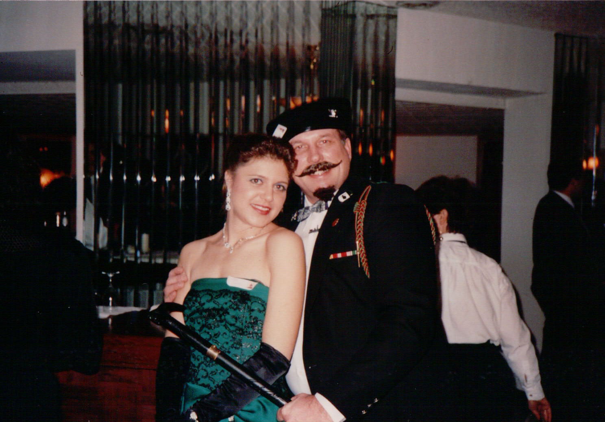

# Today's The Day!

*Originally published 2007-01-21 on the Blogspot site*

Greetings Fans,
Today is the day, some indeterminate number of years ago, that our starlet entered the world.  Let's take a few moments to review Carol's stage life...

Carol started her acting career at a young age, with the roles of Tigger, and a key part in the marching band ensemble in The Music Man in grade school.  Some time later, she was cast in the role of Peg Knuckles in a New Year's Eve Murder Mystery Drama.  We have managed to acquire this rare casting photo from that performance.

 

Happy New Year! (circa 1992)  Peg Knuckles

Sadly, this was to be Carol's last theatrical performance for some time.  After spending too many years as a corporate drone, Carol's passion for performing was forgotten.  Her creative spark was all but extinguished by the numbing boredom of courseware maintenance and project management.  Years of cubicle dwelling had withered Carol's spirit... but not crushed it completely.  Near the end of her corporate career, Carol got a taste of performing once again.  Facilitating and Training started to awaken those long dormant feelings; the thrill of the stage, the energy of the audience.  Something started to stir in Carol's soul.

In the Fall of 2004, the shackles were broken, when Carol was relieved of her job of 19 years.  Free at last!  Not knowing where to start, Carol took some acting classes to explore her options.  That spark which had been smoldering deep in Carol's soul, sprang to life!  This is what she needed to be doing!  The tinder was added to the fire, and her passion was re-ignited!

From there, we know the story.  Seven episodes of Prison Break, Chow's Chinese, The Strip, Movin' Right Along, The Wizard of Oz, two episodes of ER, Fred Claus, The Memory of Water, and in the coming months, the children's show The Mystery of the Missing Moon.

After an indeterminate number of years in the making, Carol's acting career has been jump-started, and her creative fire is burning once again.  Here's looking forward to many more years of entertainment and passion.  Happy Birthday, Babe!
-- Love, your biggest fan.
