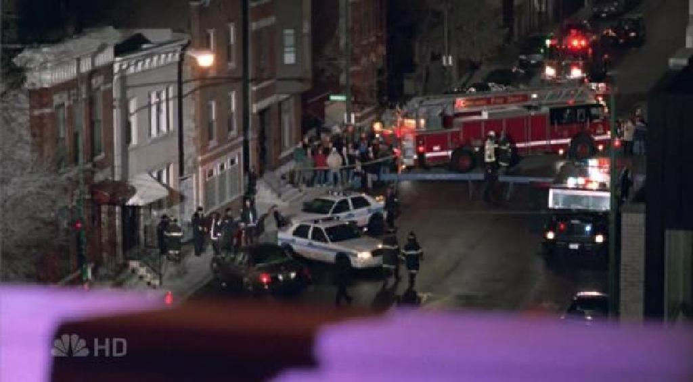
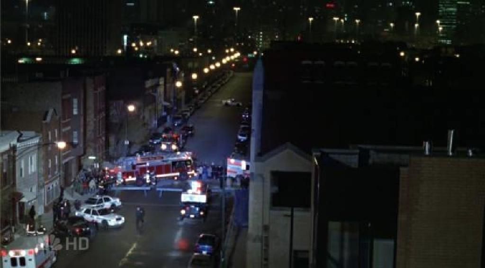
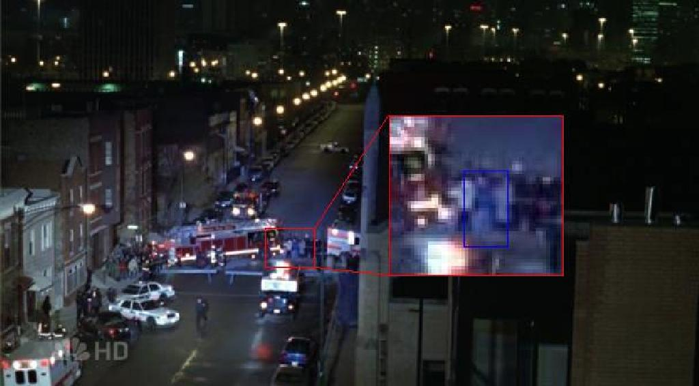
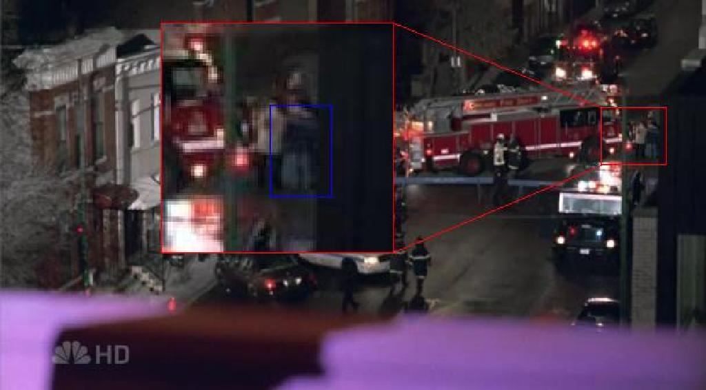

# Who's That Blur?

*Originally published 2007-02-02 on the Blogspot site*

[Last night's episode of ER](http://www.tv.com/er/murmurs-of-the-heart/episode/927267/summary.html?tag=ep_list;ep_title;13) marked the second half of Carol's ER premier.  During the scene where Luka was being held at gunpoint on the roof by Curtis, Carol was one of the bystanders just in front of the fire engine.  She was clearly (ok-- perhaps not quite clearly) visible in her blue coat and light-blue jeans, in two shots.  The first shot was at 40:40 into the episode, as the camera looks past Curtis and focuses on the crowd below, as shown here:

The second shot is in the last two seconds of the episode, at 43:06, just before the fade to black and the credits.  The helicopter searchlight illuminates the crowd standing in front of the fire engine, as shown here:

What?  You can't see her?  She's right there!  Just in front of the fire engine.  There's a guy in a light coat, and just next to him is a woman in a blue coat.  That's her!  Ok, ok... you need some help.  Allow me to focus your attention.  See the screen grabs below.  Click to enlarge.

