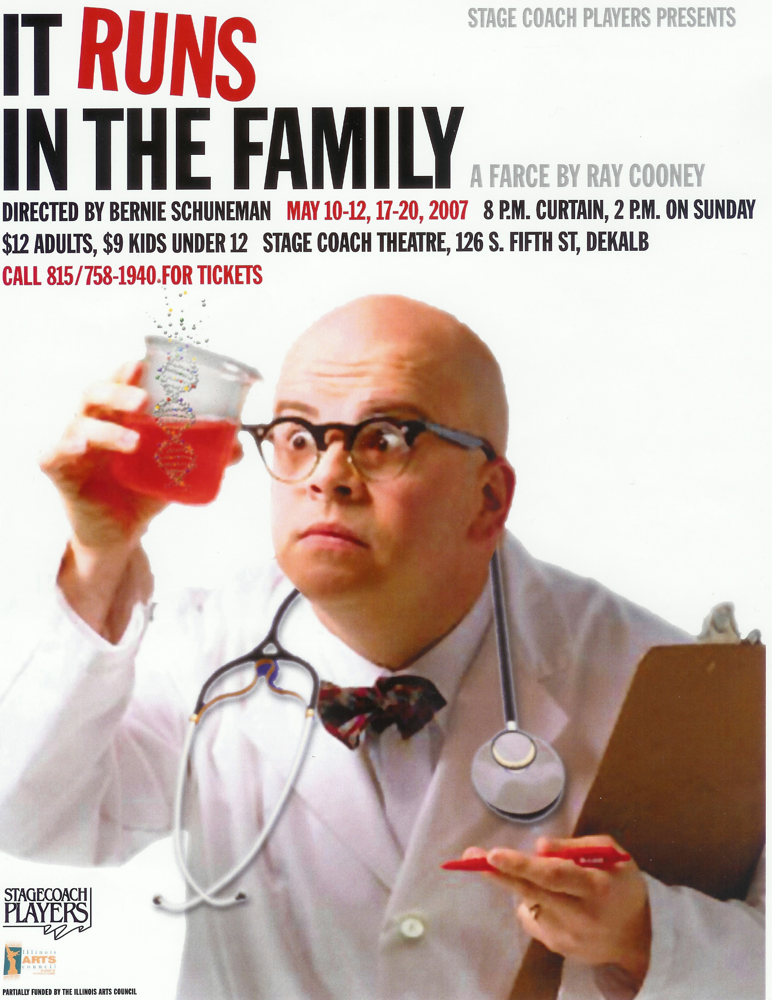

# It Runs In The Family

*Originally published 2007-05-06 on the Blogspot site*

This just in...

[Stage Coach Players](http://www.stagecoachers.com/index.html) is proud to announce that "It  Runs in the Family" directed by Bernie Schuneman will be our first show.   This show runs May 10th-12th and May 17th-19th at 8pm and Sunday May 20th at  2pm.  All performances will be at our theater which is located at 126 S 5th  Street in DeKalb, Il.

Set in the doctor's lounge of a London hospital  three days before Christmas, the staff is preparing the annual holiday show. But  that is only the sideshow. The real business is a conference of neurosurgeons.  As Dr. David Mortimore is preparing his speech for the prestigious Ponsonby  Lecture, that should guarantee him a knighthood and the hospital some badly  needed funds, a former nurse, an old flame, bursts in with the news that their  fling some 18 years and 9 months ago made Mortimore a father. The boy is  downstairs desperate to meet his long lost Dad. In true farce style, lies pile  on lies, as the doctor enlists his colleagues to deceive his wife, his boss, a  police sergeant and even his newfound son. Sharp syringes, crashing wheelchairs,  squirting seltzer bottles, doctors disguised as nurses, and window ledge  wrestling matches gear the farce into overdrive.

The box-office will open on Sunday, May 6th, and will be open from 6-8pm  through Saturday May 19th.  On Sunday May 20th the box office will be open  from noon to 2pm.

Tickets can be ordered by phone by calling 815-758-1940.

