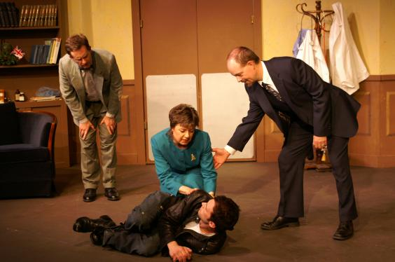
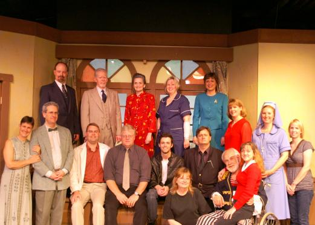

# It Ran In The Family

*Originally published 2007-05-22 on the Blogspot site*

It Runs In The Family has run its course.  Thanks to all of Carol's fans who were able to make the trek out to DeKalb to enjoy the show! And for those of you that weren't able, you'll have another chance for Carol's next show in October, with [The Crucible](http://www.stagecoachers.com/2007/2007_H.html).

What is Carol working on in the meantime?  Today, Carol had an audition for a television commercial, as Wife #2.  Wednesday and Thursday this week, Carol has been booked for more background work on [The Return](http://imdb.com/title/tt0981072/).  This time, Carol will be appearing as her [alter-ego "Babs"](http://caroltownsendfan.blogspot.com/2006/05/dont-drink-water-spoilers.html), in a night-shoot house party scene at a house in Barrington. Friday, it is an audition for another commercial!  It is only a matter of time before Carol dominates all media!

---

## Comments (1)

*Reader comments, as captured from the Blogspot site.*

**Anonymous** — *2007-05-29*

> Hey Carol,
> What a hoot! I loved the website. Hopefully, I'll get to see you when you're in town for the Crucible. Love ya,
> Amy
