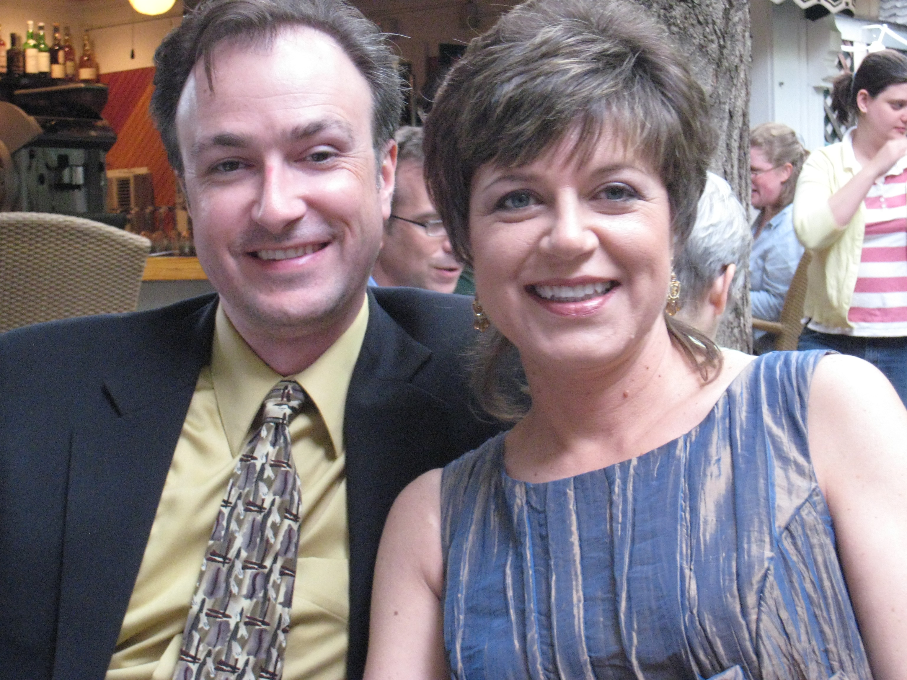
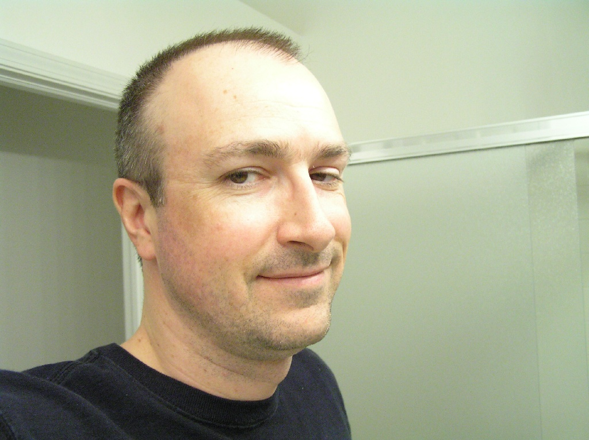

# No Carol News Here

*Originally published 2007-07-30 on the Blogspot site*

Hi all,
This post does not involve Carol at all, (except for the fact that none of the following would be happening if not for Carol), but I thought I would post a little somewhat unrelated news.

Since we worked together on [Fred Claus](http://caroltownsendfan.blogspot.com/2007/01/fred-claus.html) in January, Joan Philo casting has my name and casting photo.  So, last week I got a call asking if I could be available for an upcoming scene in [Rory's First Kiss](http://imdb.com/title/tt0468569/)!  I have no intention or desire to become a regular background actor (I'll leave that to Carol)-- but since this is Ba-- er... Rory's First Kiss-- and I get a costume and everything-- how could I refuse?!

So, this past weekend, I went downtown for my costume fitting, and got decked out in GCPD's finest gear (turtleneck, uniform shirt, pants, boots, and hat--I wonder if we'll get guns, badges, and riot gear on the night of the shoot?)  As I was leaving the fitting, some guy asks me, "What part are you?"  I told him I was a policeman, and he says. "Turn around."  I do so, and he says "Let me trim you up a little."  OK, sure.  So, I sit down, and he whips out the clippers, to "trim me up a little" (my hair, that is).

To the left is me (and Carol, sporting her RFK hairstyle and dress) before.  Long story short (as my hair), I'm now sporting the "cop's haircut" (see below).  I had been toying with the idea of going with a shorter style, so this is an interesting way to try it out.  I have to say, I like the reduced maintenance!

 

My call time is this Wednesday at 10:00pm, possibly continuing Thursday night.  So, I got a free haircut, and a couple of sleepless nights where I get to play a policeman!  As did Carol when she worked a scene for RFK last month, I had to sign an NDA.  So, I won't be able to disclose any details.  No spoilers here!

---

## Comments (3)

*Reader comments, as captured from the Blogspot site.*

**Skibit** — *2007-07-31*

> Looks good...even better than before.  How about a few more pictures to confirm that the one posted isn't just a fluke.  Kelli was sweet on you before, I'll have to ask her about the new dew.

**Anonymous** — *2007-07-31*

> Nice haircut Mark..   Looks good on you babe!!!!  
> PS  What's an HTML tag?

**Anonymous** — *2007-08-03*

> Police uniform huh?  Are you sure that there aren't other characters in your scene that are dressed like a Construction worker, Native American Chief, Biker, Soldier and a Cowboy?
