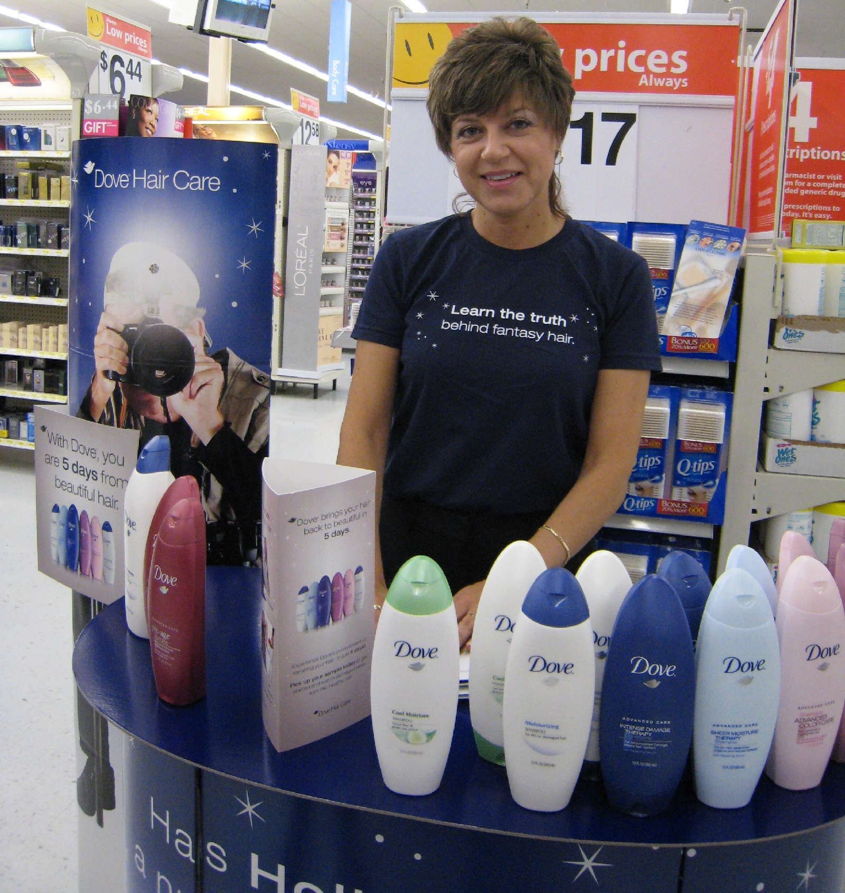
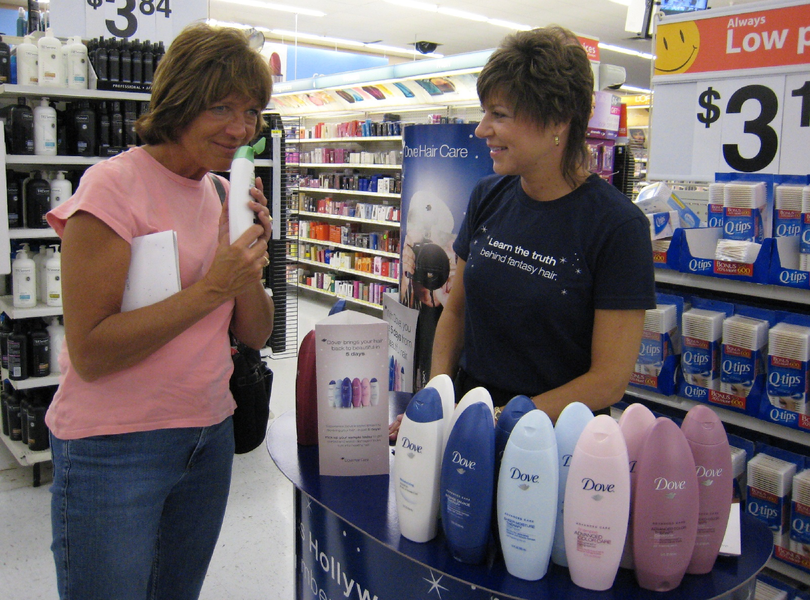

# Looking for Some Real Talent?

*Originally published 2007-09-15 on the Blogspot site*

Then look no further!  Carol is now listed with [Real Talent, Inc.](http://realtalentinc.com/), which is used by advertisers for casting people for magazine ads, corporate brochures, catalogs, and web advertising.  Need someone to model that new iPod?  Maybe a new face for your corporate capabilities presentation?  Carol can do it all!  You can find her photos on [this page](http://69.215.33.50/netpub/server.np?quickfind=40%27s-female&catalog=catalog&site=Bravado&template=results.np&offset=200), or direct links to her photos [here](http://69.215.33.50/netpub/server.np?find&catalog=catalog&template=detail.np&field=itemid&op=matches&value=7405&site=Bravado) and [here](http://69.215.33.50/netpub/server.np?find&catalog=catalog&template=detail.np&field=itemid&op=matches&value=7406&site=Bravado).

Your one-stop destination to beautiful hair.

If you didn't visit the Wal-Mart in DeKalb or Elk Grove Village this week, you have missed your chance to have [beautiful hair in only 5 days](http://www.dove.us/your_hair/default.asp).  I'm sorry, but someone had to say it.  Fortunately, Carol had a record turnout, and she helped countless women and men with their hair issues.

"It even smells beautiful!", commented one happy customer.

Today is your last chance to see Carol live and in person at the DeKalb Wal-Mart!  If you're in the market for some chips and salsa or parsley dip, you can't pass up this chance to pickup a free sample of Knorr Pico de Gallo and Creamy Parsley Dip.  Carol made it herself, and you know what a [culinary master she is](http://caroltownsendfan.blogspot.com/2006/03/janies-cream-cheese-pie.html)!

---

## Comments (1)

*Reader comments, as captured from the Blogspot site.*

**Anonymous** — *2007-09-16*

> That customer already has beautiful hair.   LOL.
> Ya know, she almost looks like she could be Carol's sister.
