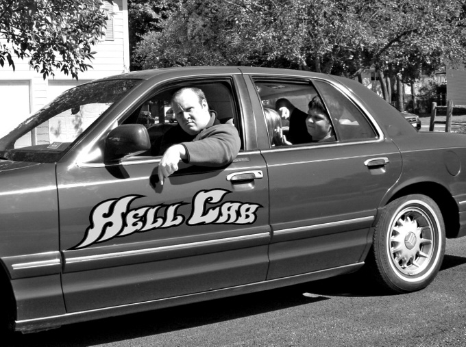

# Hellcab

*Originally published 2007-10-04 on the Blogspot site*

FOR IMMEDIATE RELEASE

**Theatre-on-the-Hill Goes for  a Wild Ride in "Hellcab," Opening October 26**

An eclectic collection  of scenes from a day in the life of a Chicago cab driver, Hellcab is  a raucous new play that cruises through episodes that range from the  absurd to tragic, mirroring the craziness that can ensue when strangers  from all walks of life meet for a few brief moments.

Beginning with an early  morning trip by a born-again couple, the daylong journey hurdles to  a poignant final scene. Alternately frightening, hilarious, and touching,  well-acted scenes are punctuated by strategically placed blackouts and  music.

The Chicago Tribune said  in a recent review, "Despite rough language and some truly nasty bits, [the play] is a joyous and spirited choice for the Christmas season.  HELLCAB [is] a real joy ride."

Bolingbrook’s Patrick  Green has multiple roles in the show and says, "This play is so unique--it’s  not about sets or props, it’s all about acting and dialogue. As an  actor it’s a unique challenge, and for audiences, it will be a distinctly  different and thoroughly enjoyable theatrical experience."

Hellcab is directed by  Mary Pavia, assisted by producer Tim Feeney, and executive produced  by Craig J. Engel. Cast members include Patrick Green and Cameron Nowicki  of Bolingbrook, Dave Callaghan of Downers Grove, Jeanne Scurek and Sarah  Conrad of Aurora, Karen Arnold of Westmont, Carol Townsend and Joe Mennella  of Carol Stream, Wally Roche of Chicago, Mary Ellen Druyan and Lori  Proksa of Clarendon Hills, Danna Durkin of Darien, Scott Boland of Willowbrook,  Dana Buxbaum of Lockport, Jannete Quinn of Wheaton, Graig Mason of Westmont.

"Hellcab" opens  on Friday, October 26 and continues until November 18 at Bolingbrook’s  Performing Arts stage, 375 W. Briarcliff, behind the Town Center Building.  Friday and Saturday shows start at 8:00 pm; Sunday matinees begin at  3:00 pm. Doors open 30 minutes prior to show time. General admission  tickets cost $14.00 for adults; $11.00 for students. For  more information, visit [www.tothbolingbrook.com](http://www.tothbolingbrook.com/).

Photo caption

Chicago’s Wally Roche can’t believe  the antics of his latest customers In Theatre-on-the-Hill’s latest  production, "Hellcab." Visit [tothbolingbrook.com](http://tothbolingbrook.com/) or call Executive  Producer Craig Engel at 630-759-2970 for additional details.
