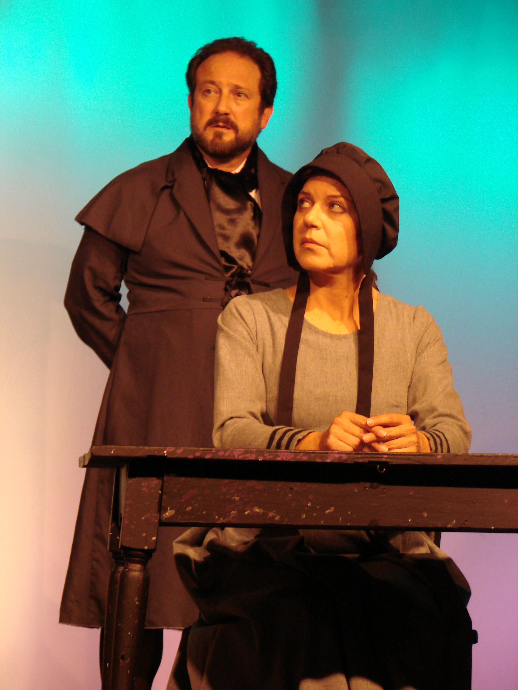

# Which witch is which?

*Originally published 2007-10-06 on the Blogspot site*

One week down, one to go-- only four more chances to see the Crucible before it closes!  I am planning to attend next Friday  (10/12) and Sunday (final show).

Not only will you get to see Carol portray the smiling Ann Putnam (see below), but she also plays Sarah Good and Martha Corey (both accused of witchcraft).  Not since [The Wizard of Oz](http://caroltownsendfan.blogspot.com/2006/11/to-wizard.html) has Carol had to stretch herself to play so many parts (Winkie #6, Ozian #15, and Jitterbug #14).

Ann Putnam, looking uncharacteristically cheerful
after having lost seven of her eight children,
presumably due to witchcraft.

If you in the mood for an uplifting tale of witchcraft, intolerance, and good old fashioned hysteria (just in time for Halloween), look no further!  Head right on over to the [Stage Coach Players](http://www.stagecoachers.com/Ticket/Ticket_Info.html) and score some tickets, while you still can!
