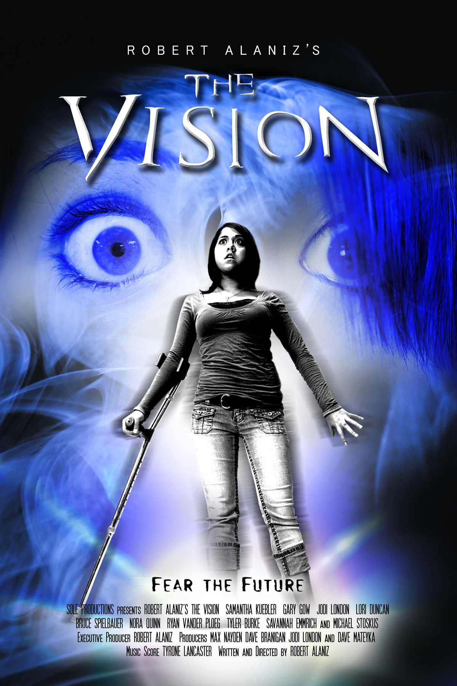

# The Vision

*Originally published 2008-03-27 on the Blogspot site*

Hello Fans,
Our starlet has been very busy!  In between auditions, and [improv performances](http://caroltownsendfan.blogspot.com/2008/03/murder-at-arcada-casino.html), and marketing promotions, she has also found time to appear in a local independent film: [The Vision](http://imdb.com/title/tt1161458/).

"When an over ambitious reporter stirs up an old controversy surrounding a series of unsolved murders, a clairvoyant teenage girl and her friends enlist the help of a college professor with a plan to expose the identity of the killer, when it is believed that the girl's reoccurring vision may be the murder of the professor."

Carol has a small part, playing newspaper editor, Katherine Morrissey.  The film is a project of [Sole Productions](http://www.sole-productions.net/current.htm), and local filmmaker Robert Alaniz, and has been shooting in the southern suburbs.   The film will premiere in theaters in October 2008, with a DVD release to follow.  You can watch the trailer on [YouTube](http://youtube.com/watch?v=lkm0UjDgzpQ).
