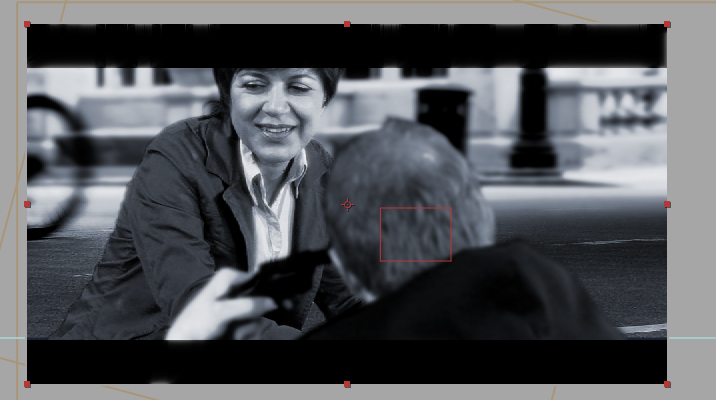

# Murder, Dodgeville, and Overproof

*Originally published 2008-05-16 on the Blogspot site*

Welcome back fans!
Forgive me for the long drought of new information. Contrary to my lack of updates, Carol has remained busy during the past month (although, sadly, she is not part of the rumored [MacGyver movie](http://www.cinemablend.com/new/MacGyver-Movie-Coming-8720.html)). Amongst the many product promotions (Oil of Olay, Serta Mattresses, and Axe Body Spray), Carol has also continued to expand her acting resume.

Back on April 28, Carol once again joined [Murders R Us](http://murdersrus.com/) for an afternoon of improv and murder. Murder at the Chop House was a private improvised murder mystery, at the Chop House in Schaumburg. Carol was excited to play Wilma Flipflappah, mayor of Hoffman Estates.

Carol also spent several days shooting a television pilot for a sitcom called Dodgeville. The show was originally shot in 2007, and submitted to the [Chicago Comedy TV Pilot Competition](http://www.witsendshorts.com/index.html). You can read about it [here](http://www.aaronmichaelreilly.com/Aaron%20Michael%20Reilly/Blog/6502CAC6-31DE-4496-AB12-95C0BD7457BC.html). Dodgeville, written and directed by Rory Bolen, is about four guys who inherit a warehouse in Dodgeville, WI, and decide to turn it into their weekend man-cave/clubhouse/getaway. Carol plays Emma Sweet, a brash middle-aged (ahem) "Cheesehead" mother of four, who hangs out with the guys to escape the madness of her life for a few hours.

And finally, Carol was cast and is in the midst of shooting a short film, called Overproof. Carol plays a detective who tries to convince a suicidal man with a bomb ([Jeff Garretson](http://www.baronvonawesome.com/jeff.html)) not to kill himself. No, that's not grass in the photo-- this was Carol's first work with chroma key (green screen).

You can view other Overproof production photos [here](http://www.flickr.com/photos/mhanley67/sets/72157605092341218/).

Don't forget, [Still Photos](http://caroltownsendfan.blogspot.com/2008/03/save-dates.html) opens on June 27 at the Trapdoor Theatre!
