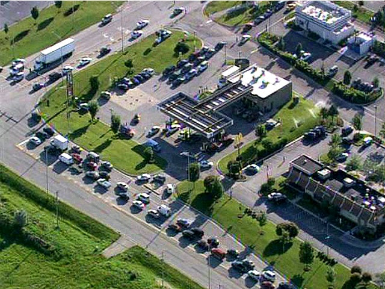

# Carol Stops Traffic in Romeoville

*Originally published 2008-06-17 on the Blogspot site*

Greetings Fans!
If you were in the southern suburbs today, you may have encountered unusually heavy traffic around Weber Rd. and I-55.  Carol was appearing at the 7-Eleven at Weber and Normantown Roads, and motorists lined-up for miles to see her.  Well, they may have also been interested in the FREE GAS that Hershey was giving away from 7am - 9am-- but I am sure that was probably secondary.  You can read about the Hershey promotion [here](http://www.thehersheycompany.com/news/release.asp?releaseID=1167001).

The event was covered by the Daily Herald [here](http://www.suburbanchicagonews.com/heraldnews/news/1009679,JO17_FREEGAS_P1.article), and on the WBBM Newsradio site [here](http://www.wbbm780.com/Drivers-Line-Up-For-Free-Gas-COMMENT/2426899).  (I especially like some of the comments at the bottom of the articles. I guess not everyone was excited about seeing Carol... or the free gas.)  There were also brief mentions on NBC 5 (you can view a slide show [here](http://www.nbc5.com/slideshow/16631840/detail.html?taf=chi)) and CBS 2 evening news in Chicago... although oddly enough, they seemed to focus on the free gas rather than on Carol's appearance.
