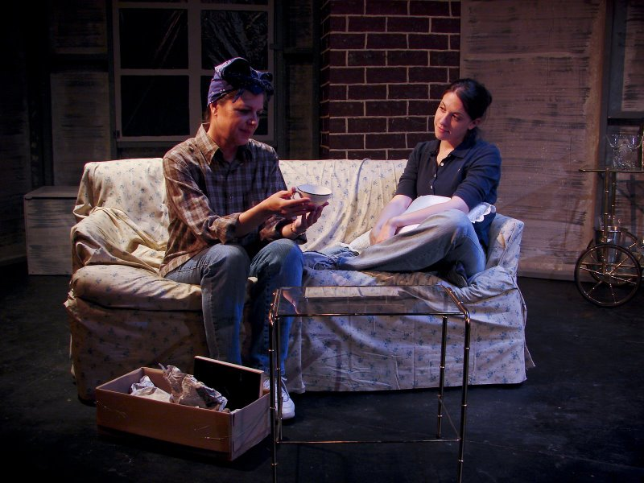

# Still Photos

*Originally published 2008-07-05 on the Blogspot site*

Happy Independence Day!!
We broke tradition this year and did not get to see the fireworks in Lombard, as we normally do.  Instead, we spent the day at the theater, seeing [Kooza](http://www.cirquedusoleil.com/CirqueDuSoleil/en/showstickets/kooza/tickets/chicago.htm)at the United Center, followed by Carol in [Still Photos](http://www.pointofcontention.org/stillphotos.htm) at the [Trapdoor Theatre](http://www.trapdoortheatre.com/).

Charlie (Danielle O’Farrell) and Aubra (Elisé Lammers) share a moment

We see the relationship between Aubra and Charlie blossom through the memories of Grandma (Charlie, in 2004), played by our own Carol Townsend.  Grandma painfully reflects on the decisions of her past, while she and her estranged granddaughter Emily (played by Megan Brown) watch the 1944-drama unfold before them.  Grandma tries to convince her 1944 counterpart to make different decisions, changing her own past... but what would this mean for Emily?  Carol shows us the painful struggle between regret of decisions past, and grateful acceptance of a life lived.

Danielle O'Farrell convincingly conveyed Charlie's exuberance and innocence; and her high-energy portrayal was a stark contrast to Elisé Lammer's dark and passionate expression of Aubra, the refined but bitter polio-stricken opera singer, who helps Charlie discover her true self.  I can't get away without mentioning the convincing portrayals of the men: Phillip (played by Brett Lee), Aubra's fiancé and care-taker; and Joe (played by Jason Ober), Charlie's enthusiastic and naive boyhood sweetheart.

There's something for everyone:  love, war, drinking, girls kissing, parades, 1940s music, dancing, and even a temporal paradox!

Still Photos is undeniably the best lesbian love story I have ever seen!  There, I said it.  You need to go see this show!
