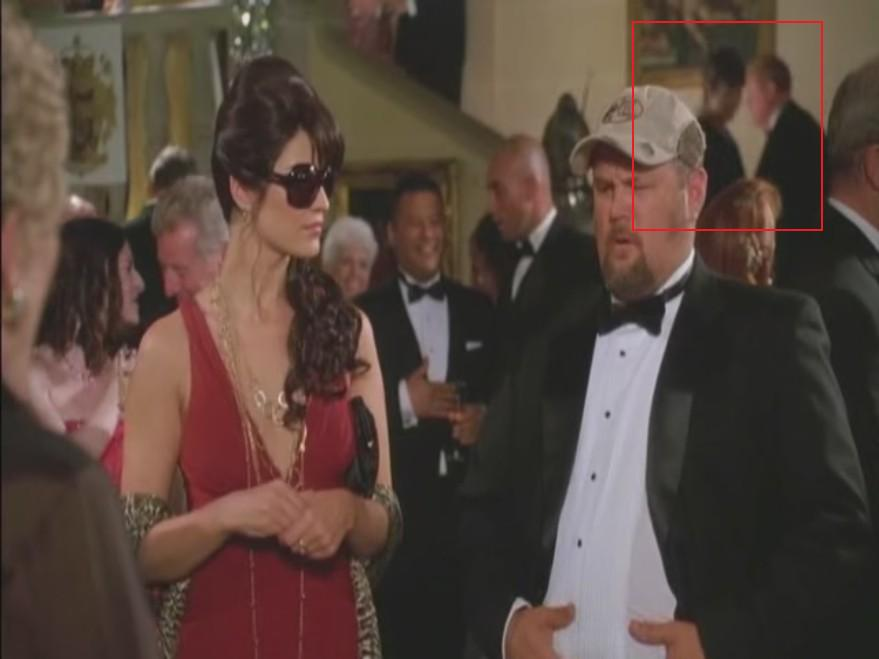
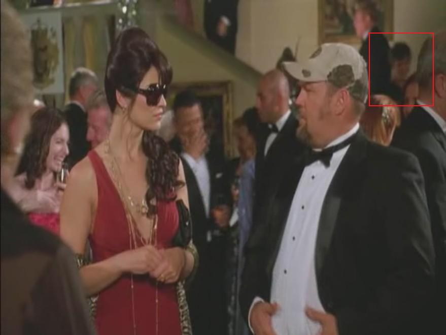

# I gotta go pinch out a grumpy

*Originally published 2008-08-04 on the Blogspot site*

Greetings Fans!
You may recall from [last year](http://caroltownsendfan.blogspot.com/2007/06/witless-protection.html), Carol worked on a scene in [Witless Protection](http://www.imdb.com/title/tt1001562/).  We never got a chance to see it in the theater (and having seen parts of it now, I guess that might not be a bad thing).  However, in one memorable scene, you can catch a glimpse of Carol over Larry the Cable Guy's left shoulder.  Perhaps not the most prestigious scene, but a memorable line, nonetheless!

"I tell you what..."

"... that beef jerky and marmalade ain't sittin' too good.
You got a crapper?  I gotta go pinch out a grumpy."

Carol looks radiant as she descends the stairs, smiling as she greets some unseen acquaintance...  oblivious to the gastrointestinal distress occurring just across the room!
