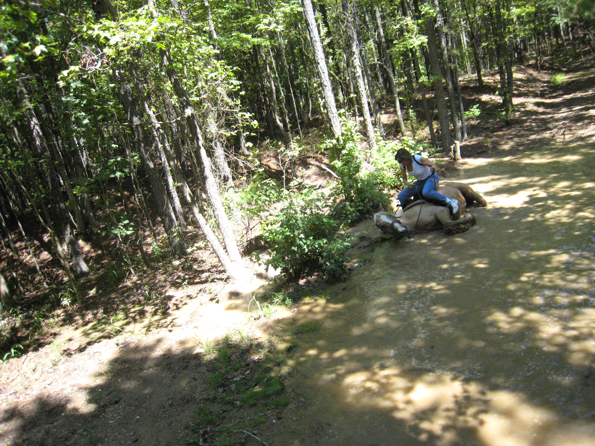
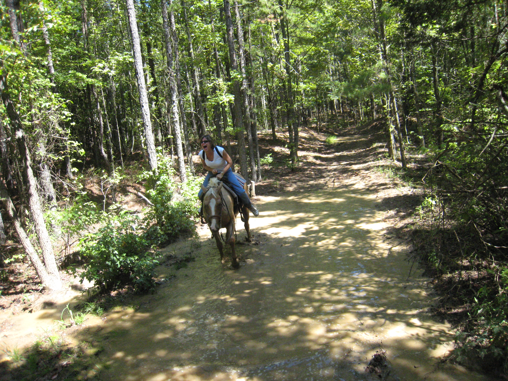
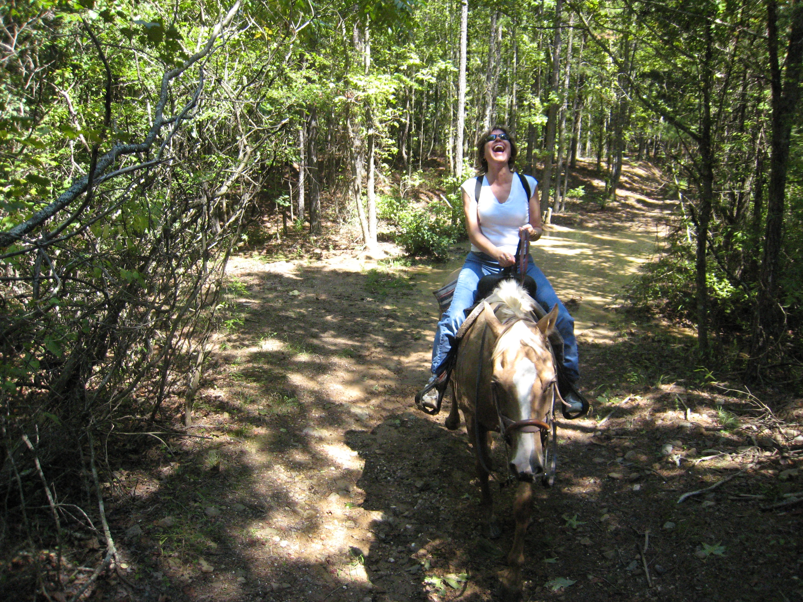

# A Near Tragedy

*Originally published 2008-09-13 on the Blogspot site*

Greetings Fans,

While relaxing on a recent vacation (long weekend) in Hot Springs, AR [by the way... while Hot Springs is beautiful... I do not recommend driving from Chicago], the entertainment world nearly lost one of its most promising rising stars when Carol narrowly avoided being crushed by a runaway horse!  Fortunately, I was ready with the camera and was able to capture the terrifying spectacle.  I warn you, the following narrative and pictures may be disturbing to young children, or those easily terrified by renegade farm animals.

As we guided these wild thousand pound monsters through the rough wooded terrain, we came upon a raging torrent of runoff from the recent rain storms.  One by one, we coaxed our beasts through the turbulent waters, fighting to keep them under control.  Finally, following the rest of the group, Carol's horse entered the water.  Suddenly, her horse began thrashing its feet, churning the muddy water until it boiled, much like a Venti Latte you might order from Starbucks.  Carol tried in vain to move her horse safely through the raging water, but it was beyond convincing.  Then, without warning, the horse dropped to its knees in the swirling flood.  Carol screamed!  In horrifying slow motion, the beast started to roll over, as if to crush the rider on its back.

Thinking quickly, Carol pulled her right foot from the stirrup, just as the horse's weight would have surely crushed it.  Yanking back on the reins to regain her balance, Carol managed to stay atop the capsized equine.  Having realized it would not taste human blood this day, the horse righted itself and, with Carol still in the saddle, it stood up and sloshed the rest of the way through the raging torrent.

Finally out of danger, Carol let out a triumphant cry!  The animal had nearly won.  Only by her quick thinking and grim determination was Carol able to remain in control, and break the will of this demon steed.  The remainder of the ride was uneventful.  It had been beaten, and it knew it.

