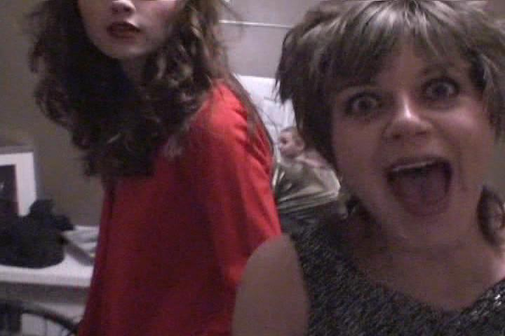

# Murder at the Arcada Casino -- revisited

*Originally published 2008-09-18 on the Blogspot site*

Hello Fans!

[Back in March](http://caroltownsendfan.blogspot.com/2008/03/murder-at-arcada-casino.html), Carol worked with [MurdersRUs](http://murdersrus.com/), and appeared in an improvisational murder/mystery called Murder at the Arcada Casino.  In addition to the actual stage performance, the entire concept is being considered for a reality TV show.  A film crew was on hand to capture the entire process, from auditions, casting, rehearsal to performance, plus all the backstage antics.  You can view at the promotional trailer right here:

**

"Murder at the Arcada Casino"

Written, Directed, and Produced by Paul Warshauer, MurdersRUs.

Although Carol had a more prominent role in the staged performance, she managed to avoid the film crew, aside from a few brief appearances.  In case you blinked and missed her appearance (at 5:49 into the video), here's what you missed:

Eiahhh!  Get that camera out of the dressing room!
