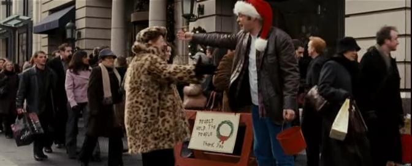

# Fred Claus: Revisited

*Originally published 2008-12-01 on the Blogspot site*

A belated Happy Thanksgiving to all the fans out there!  Please excuse the extreme gap between posts.  Carol has been busy working various product promotions, preparing a fabulous Thanksgiving dinner, and various auditions.

In the meantime, let's revisit some news from almost two years ago.  Back in [January 2007](http://caroltownsendfan.blogspot.com/2007/01/fred-claus.html), I wrote about our adventures working in the cold Chicago streets as extras on [Fred Claus](http://www.imdb.com/title/tt0486583/).  We saw the movie in the theater last Christmas, but we couldn't identify whether we made the cut or not.  Now that the movie is out on DVD and Pay-per-view, we were able to take a closer look. Amazingly, out of the 100s of extras that were working, Carol and I made it to the screen!

At 14:45 into the movie for a full 5 seconds, you can catch us walking behind Fred (Vince Vaughn) as he is ringing a bell and asking for donations.  Just as he says "Hey there, gimme a hug ... you gorgeous leopard, meow!  Who's the queen of the jungle?  You are!", Carol and I are walking right behind him.

If you blink, you're liable to miss it.  So here, I've captured the moment for you.

Humbug! Busy shoppers, Mark and Carol, ignore the guy in the Santa hat.

At the extreme screen right, you'll see Carol and me just about to walk off the screen. Another 5 seconds of fame.  It's cumulative, right?
