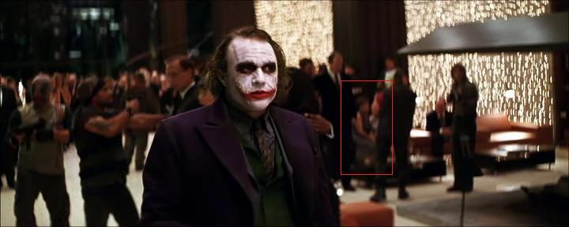

# A Dark Knight Moment

*Originally published 2008-12-01 on the Blogspot site*

... and one more, while we're at it.  As you may have seen mentioned elsewhere on this site, both Carol and I also worked on The Dark Knight.  In a cruel irony, I was clearly visible in one scene for almost 30 seconds (and a few seconds in two other scenes), but we weren't able to spot Carol when we saw the movie in the theater.

That said, having been able to take a... closer look... I can now confirm that Carol did, in fact, make the final cut!  In the scene in Bruce Wayne's penthouse (as not described in [this blog post](http://caroltownsendfan.blogspot.com/2007/06/rfk-no-spoilers-here.html)) when the Joker crashes the party and is terrorizing the guests, as he is walking over to confront Rachel, you can catch a glimpse (albeit blurry) of Carol sitting on a couch in the background.

Holy partycrashers!  Carol cowers on the couch as the Joker menaces.

See her?  Just to the right of the Joker's left shoulder.  I've highlighted her in the picture above (click for a larger version).  That's Carol, I swear!
