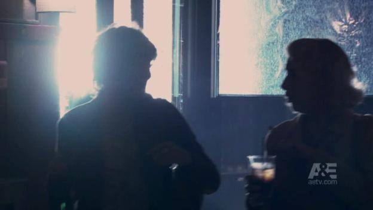
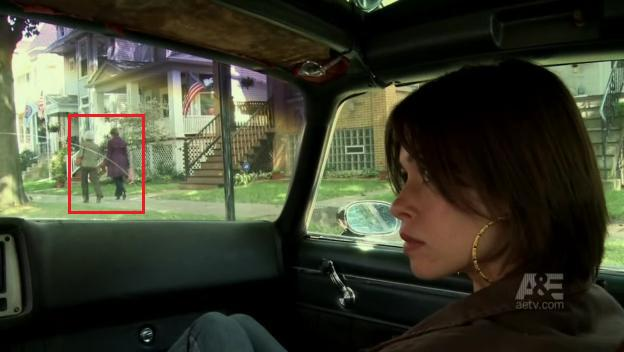

# Carol's Return to TV

*Originally published 2009-01-31 on the Blogspot site*

Greetings Fans,
As I reported [back in August](http://caroltownsendfan.blogspot.com/2008/08/carol-works-beast.html), Carol had worked background on several episodes of [The Beast](http://www.aetv.com/the-beast/), the new A&E drama starring Patrick Swayze.  The Beast airs on Thursday nights at 9pm on A&E, and last Thursday was episode three which marks Carol's return to television!

Not since season one of Prison Break have we seen Carol's face on TV (and truth be told, we can't really see her face this time either).  In this episode, we spotted Carol in two different scenes.  The first is at 11:31 into the episode, Carol and a friend are walking past the door just as Patrick enters a Romanian bar.  Carol is backlit and her face is in shadow, but we are certain that is her on the left.  She walks out of frame just as Patrick enters the bar.

Carol (left) and a friend in the Romanian bar

Later in the episode, at 36:34, we see Carol (and the same friend-- they really get around) walking down a sidewalk.  We see her twice in this scene, through the windshield in the shots with Nadia looking out the window.  Carol is wearing her fabulous purple raincoat, which was unusual for background wardrobe.

Carol in purple raincoat, stumbling home from the Romanian bar

We can look for Carol again in next week's episode.  She is reportedly in a scene near "[The Bean](http://www.millenniumpark.org/artandarchitecture/cloud_gate.html)", and possibly walking outside the Cultural Center.  Later this season, in episode seven, you can look for both Carol and I, and my car.  Stay tuned for details...
