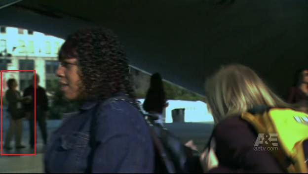
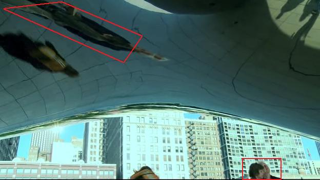

# Contemplating The Bean

*Originally published 2009-02-16 on the Blogspot site*

Greetings Fans!
Carol's TV appearances continue as she could be seen once again in [The Beast](http://www.aetv.com/the-beast/).  In the beginning of episode 4, Carol can be seen contemplating The Bean (or [Cloud Gate](http://www.millenniumpark.org/artandarchitecture/cloud_gate.html), if you prefer), as the woman with a backpack runs through while talking on a cell phone.

Carol (left) contemplates her reflection in The Bean.

A few seconds later, she can be glimpsed again (although only barely) as Travis rides through on his stolen bicycle.  Interestingly, you can also see her reflection overhead, fun house-style.

As both the backpacked woman and Travis leave the scene, you can glimpse Carol's disembodied head at the bottom of the screen, and distorted reflection above.  Next week in episode 6 of The Beast, and both Carol and I (and my car) may make appearances.  Stay tuned!

If you haven't seen [Key For Two](http://www.riverfrontplayhouse.com/nowshowing.html) yet, you only have four more chances!  Why not bring your sweetheart to see a hilarious show about infidelity to make up for the lame Valentine's Day gift you got them?  Don't miss out!
