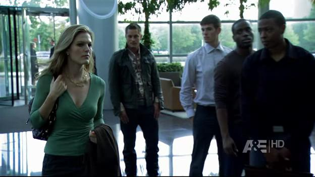
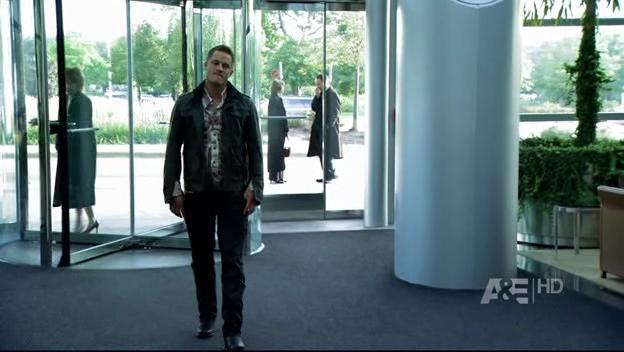
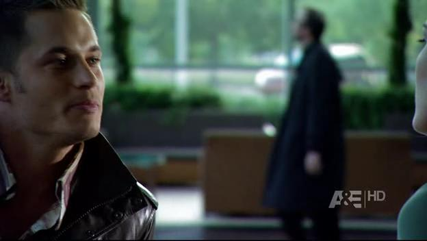
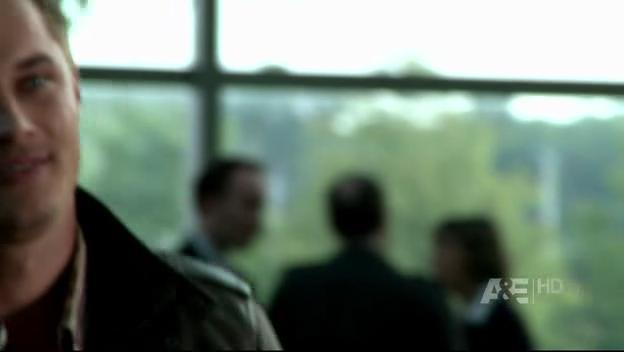
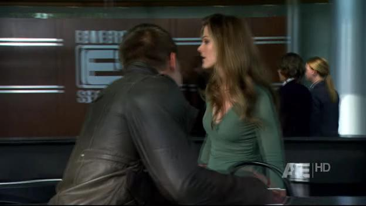

# Final Appearances on The Beast

*Originally published 2009-02-20 on the Blogspot site*

Yesterdays episode of [The Beast](http://www.imdb.com/title/tt1103968/) on A&E marked the final appearance of Carol (and me!) on this series.  First, when Travis goes undercover to apply for a job at Emerson Security, Carol can be seen standing outside the revolving door chatting with a co-worker.

Later, as Travis is rebuffed by the hot receptionist, you can see me stroll across the lobby, and then both Carol and I can be seen standing and chatting behind Travis.

The next day, Carol can be spotted walking down the windowed corridor as Travis chats on his phone.

Thus ends another exciting string of Carol (and Mark) sightings.  Unfortunately, we don't have any further television or movie appearances lined-up, so in order to get your fix of seeing Carol perform, you MUST come and see [Key For Two](http://caroltownsendfan.blogspot.com/2009/01/not-tea.html) at the [Riverfront Playhouse](http://www.riverfrontplayhouse.com/) in Aurora!  Only THREE shows remain!  You do not want to miss this opportunity!
