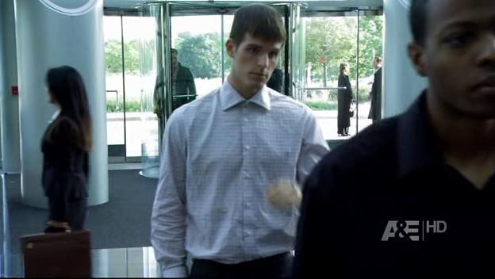
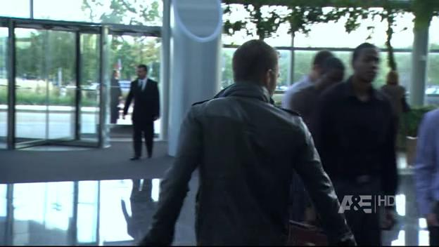
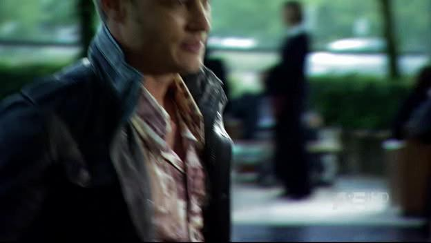
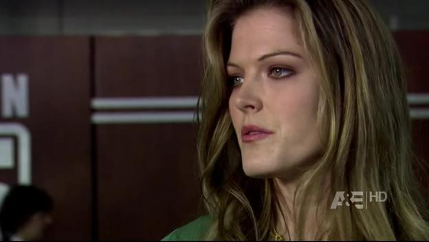
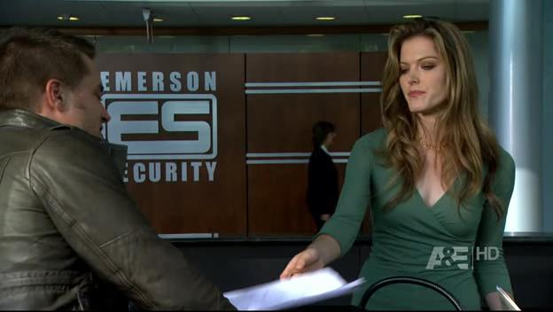
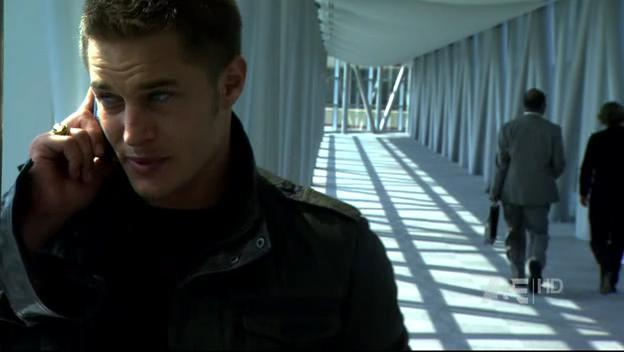

# A New Record!

*Originally published 2009-02-23 on the Blogspot site*

Greetings Fans!
As reported last week, Carol (and I) made our last appearance in The Beast last Thursday night.  After reviewing the scene even more closely, we found three more shots with Carol visible!  This brings the total Carol sightings to nine in this single scene, and ten for the episode.  This marks a new record! Six sightings was the record for a single episode, previously held by Prison Break, season 1 episode 22, where we can see Carol (as "Babs") six times during the scene.  Prison Break, [season 1 episode 16](http://caroltownsendfan.blogspot.com/2006/04/prison-break-trifecta.html) still holds the record for number of appearances as different characters.  We see Carol as a prosecuting attorney, a commuter on the L platform, and a restaurant patron.

In this episode of the Beast, Carol is a whirlwind of activity, as you'll see by the time line below:

At 8:26, we see Travis entering via the revolving door, and Carol standing outside talking with a co-worker.

At 8:29, Travis is inside, and Carol is still standing outside talking with a co-worker.

At 8:39 (several minutes later in episode time), Travis is standing in line while the hot receptionist enters and gives him the stink-eye, and Carol is still standing outside talking with a co-worker.

At 9:28, the hot receptionist sends Travis off to fill-out a form, and Carol is still standing outside talking with a co-worker.

After the commercial break, at 9:39 (and later in the day, episode time) Travis is handing in his completed form, and Carol is now standing in the lobby, chatting with a co-worker.  Glad she finally made it inside!

At 9:51, while Travis is still talking with the receptionist, Carol now enters behind the reception desk crosses right to left.  Maybe she had to go to the restroom?

At 10:38, Carol is seen starting to enter behind the receptionist, now crossing left to right.  Back from the restroom?

At 10:39, we get a wider view of Carol walking left to right behind the reception desk.

At 10:45, as Travis turns to leave, we see Carol again, now standing in the lobby talking with Mark.  She must have really hurried back to finish that conversation after just running to the restroom.  She doesn't even look winded!

Finally, at 22:58 (the next day in episode time) we see Carol walking down a hall as Travis talks on the phone.
