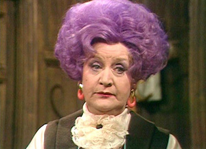

# Are You Being Served?

*Originally published 2009-11-10 on the Blogspot site*

Greetings Fans!

As we head into the holiday season, Carol is starting rehearsal for a new show.  Carol has been cast as Mrs. Slocombe in ***Are You Being Served?***  with the [Elgin Theatre Company](http://www.elgin-theatre.org/).  You may recognize the title as a British sitcom from the 1970s.  The play is a British farce, and takes place in the fictional Grace Brothers Department Store, and Mrs. Slocombe is the head of the Ladies Separates & Underwear department.

It will be worth the price of admission just to see Carol with purple hair!  The show will be at the [Kimball Street Theater](http://www.elgin-theatre.org/directions-KimballStreet.htm) in the Rider Center of Elgin Academy, in Elgin.  Show dates are January 8, 9, 15, 16, 22 and 23; Fridays and Saturdays at 8:00pm.

Tickets are $15 for adults or $12 for children and seniors.  You can purchase tickets online [here](http://www.elgin-theatre.org/tickets.htm).

---

## Comments (1)

*Reader comments, as captured from the Blogspot site.*

**Anonymous** — *2009-12-11*

> Carol, is that you??? I love it. I look forward to figuring out which date to come see the performance.Kim O
