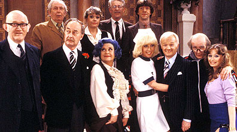

# Are You Free...?

*Originally published 2010-01-08 on the Blogspot site*

I'm free!  The snow has stopped falling and the roads should be clear, so if you *are *free tonight, why not head on out to Elgin to see Carol as Mrs. Slocombe in **Are You Being Served?**

**Are You Being Served?** opens tonight at the [Kimball Street Theater](http://www.elgin-theatre.org/directions-KimballStreet.htm) in the Rider Center of Elgin Academy, in Elgin. I will be there tonight, but if you can't make it tonight, you have five more opportunities:  January 9, 15, 16, 22 and 23; Fridays and Saturdays at 8:00pm.

Tickets are $15 for adults or $12 for children and seniors. You can purchase tickets at the door, or online [here](http://www.elgin-theatre.org/tickets.htm).
