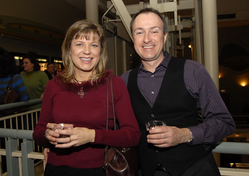

# Chicago Overcoat

*Originally published 2010-02-10 on the Blogspot site*

It's a coffin... look it up.  [Chicago Overcoat](http://www.imdb.com/title/tt1085382/) screened in Chicago last week, and Carol and I were on hand for the gala event.  Carol worked as an extra in the film, although unfortunately, we were unable to spot her on screen.

At the screening of Chicago Overcoat

Despite Carol's tragic absence from the screen, we both thought it was very well done.  It has a well-written compelling plot with a great cast, including Chicago local [Danny Goldring](http://www.imdb.com/name/nm0325975/) as the acerbic chain-smoking veteran cop.

**

Official Trailer

We would give it two thumbs-up, if that phrase was not a registered trademark of Roger Ebert.
