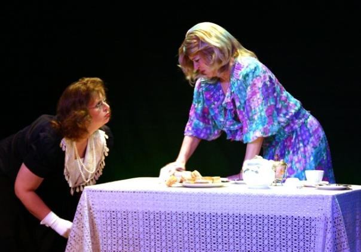
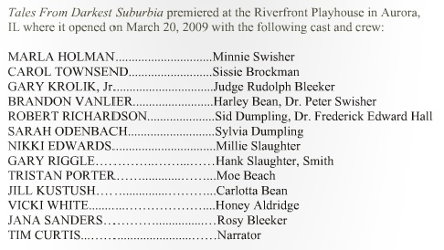

# Carol Immortalized as Sissie Brockman

*Originally published 2010-03-03 on the Blogspot site*

Greetings Fans!

Back in March 2009, Carol appeared in **[Tales of Darkest Suburbia](http://caroltownsendfan.blogspot.com/2009/03/tales-from-darkest-suburbia_18.html)**, at Riverfront Playhouse in Aurora.  Carol played Sissie Brockman in the tale in Act 1 called *The Rubbing*.

As this was the premier stage performance of this play, the original cast and crew have been immortalized in the printed script.

You can check out the whole script on the site [here](http://www.productionscripts.com/edward-crosby-wells-tales-from-darkest-suburbia-p-441.html?read_sample=yes%3E).
