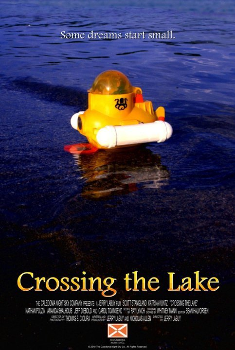
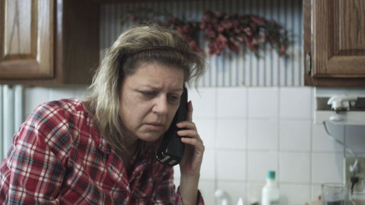

# Crossing the Lake Premiere

*Originally published 2010-05-15 on the Blogspot site*

**"After years of making excuses and putting his life on-hold, Patrick Turkel tries to stop living in his own head and dive into the real world."**

**
**

**Crossing the Lake** is a short film by Nicholas Allen & Jerry LaBuy of the Caledonia Night Sky Co.  As mentioned here [previously](http://caroltownsendfan.blogspot.com/2009/10/crossing-lake.html), Carol worked on this film last year and plays Debbie, the overbearing and sickly mother of Patrick.

Patrick?  When are you coming home?

**Crossing the Lake** premiers today at the [Gene Siskel Film Center](http://www.siskelfilmcenter.org/) in Chicago.  I would write more, but I'm late!
