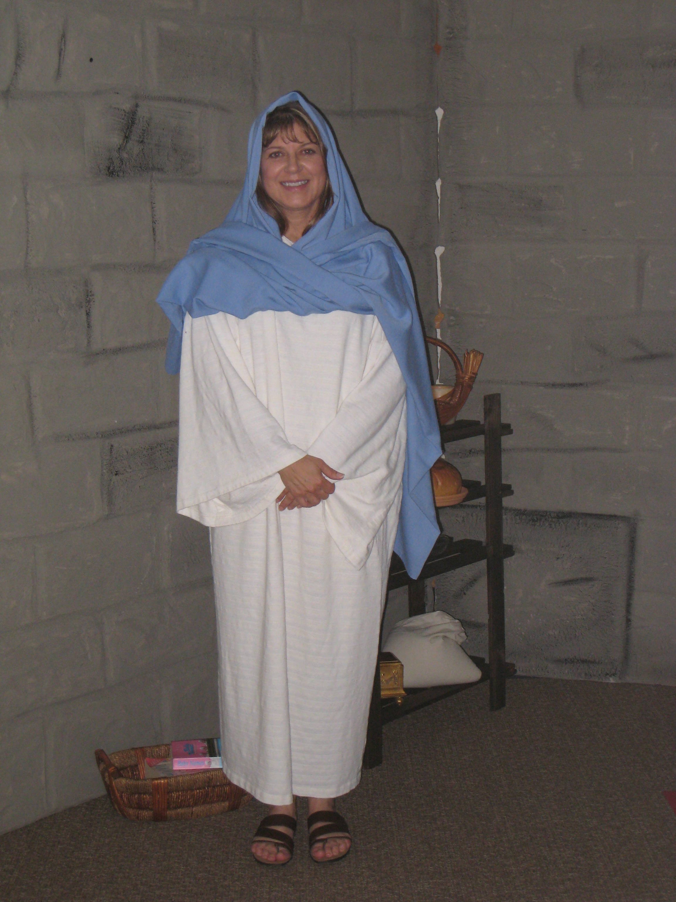

# Hometown Nazareth

*Originally published 2011-06-14 on the Blogspot site*

Greetings fans...

It has been a long news drought here on the Carol Townsend fan site.  With the onset of summer, hopefully the activity will pick up.  To that end, this week Carol is pleased to be appearing as Mary... yes, **that** Mary... ***THE ***Mary...  at the [Community Fellowship Church](http://www.commfell.org/) in West Chicago.

Their Vacation Bible School program is entitled **Hometown Nazareth: Where Jesus was a Kid**.  At Hometown Nazareth, families will meet Mary and hear stories of Jesus’ childhood and view some embarrassing baby photos.  Mary tells about how she knew that Jesus was God’s Son, and helps teach how kids can stand up for their faith in everyday life.

 (Registration is closed, however, so don't just show up expecting to get in... even if you are a huge fan!)
