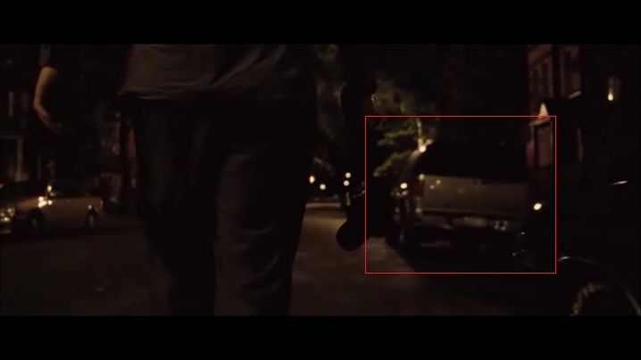
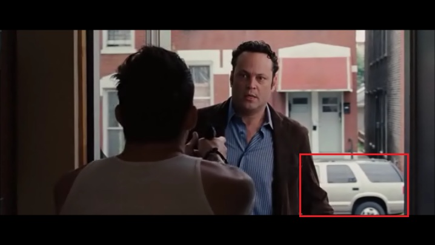
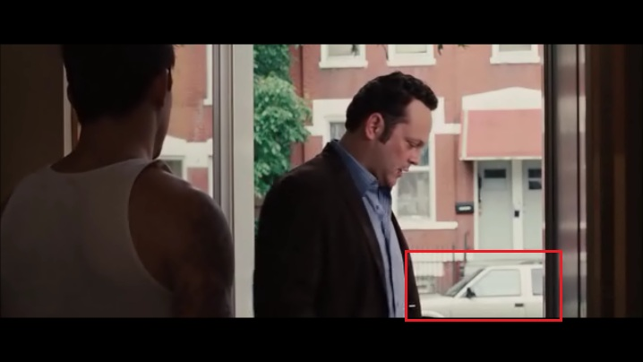

# The Dilemma

*Originally published 2011-07-24 on the Blogspot site*

A new star is born!  Last year, Carol worked background on the film, [The Dilemma](http://www.imdb.com/title/tt1578275/).  Although Carol didn't get to work on any scenes herself, they did use her car, and she did get to meet Ron Howard.  Tonight, we finally got around to watching The Dilemma, and Carol's car is clearly featured in two scenes.  When Vince arrives at Zip's house to spy on Geneva, he parks right behind Carol's car.

The next day, when Vince returns to Zip's house to get his camera, Carol's car is parked across the street, behind Vince.

Carol is so excited, she will be treating her car to a wash and a premium fill-up tomorrow!
