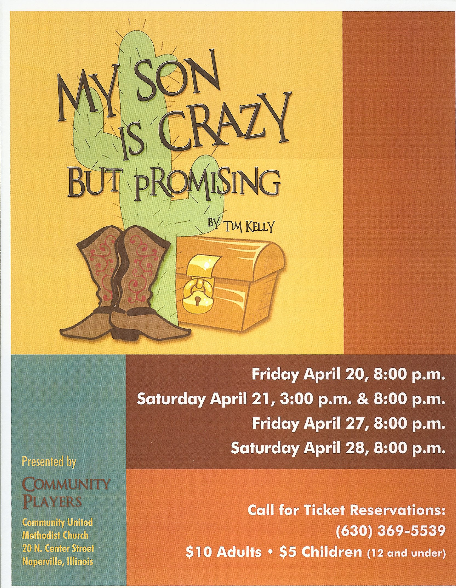

# My Son Is Crazy... But Promising

*Originally published 2012-04-04 on the Blogspot site*

Greetings fans!

It's Spring, and it's time for a new show.  We had to miss our annual trip to Thunder Over Louisville this year, as Carol has been cast in **My Son Is Crazy But Promising**, with the Naperville Community Players.

Carol will be playing Gert Witherspoon, owner of the Ritz Apache Lodge in Arizona, which is home to many colorful characters (think Fawlty Towers in the desert).  Hilarity abounds when a Hollywood low-budget screenwriter decides he wants to buy the lodge from Gert in order to find treasure in the nearby Lost Dutchman Mine.  There's a crazy lady who talks to aliens, irate tourists, an undead mobster, alligators, brussels sprouts, and the FBI. You'll just have to see the show to find out how all those things fit together!

The show is at the Community United Methodist Church, [20 N. Center Street in Naperville](https://maps.google.com/maps?q=20+N.+Center+Street+in+Naperville&ll=41.775486,-88.146186&spn=0.001386,0.002594&hnear=20+N+Center+St,+Naperville,+Illinois+60540&gl=us&t=m&z=19).

Show times are:

Friday April 20, 8:00pm

Saturday April 21, 3:00pm and 8:00pm

Friday April 27, 8:00pm

Saturday April 28, 8:00pm

Tickets are $10 for Adults, $5 for Children (12 and under)

Call the box office for ticket reservations:  (630) 369-5539

See you there!
