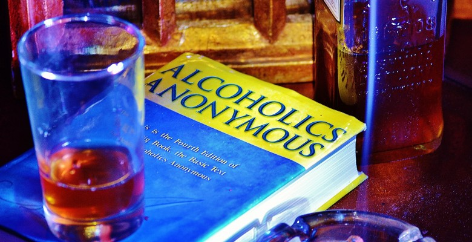

# Bill W. and Dr. Bob

*Originally published 2014-10-09 on caroltownsend.com*

Greetings Fans!

Whatcha doin' this weekend?  Why not come out to Naperville's Center Stage Theater and see our favorite actress in a show? Carol will be appearing In **Bill W. and Dr. Bob**, which is the touching story of the beginning of Alcoholics Anonymous. Carol will be playing Lois, the titular Bill's wife. This will be a unique production, presented in the form of a radio stage play.

                

Bill W. and Dr. Bob

Show times are: October 10, 11, 12, 17, 19.  Fridays & Saturdays at 8:00 PM, Sundays at 3:00 PM.

Location is: Center Stage Theater, [1665 Quincy Avenue, Naperville](https://www.google.com/maps/place/1665+Quincy+Ave,+Naperville,+IL+60540/@41.7755474,-88.1888318,18z/data=!4m2!3m1!1s0x880ef842d1b27627:0xdb03c4a5516f76b9)

Ticket info: Adults $20, Seniors/Students $15, Children 12 and under $10

To purchase tickets call 630-697-3790, or visit the [Center State Theater website](http://www.evergreentheatreensemble.org/bill-w-and-dr-bob/).
