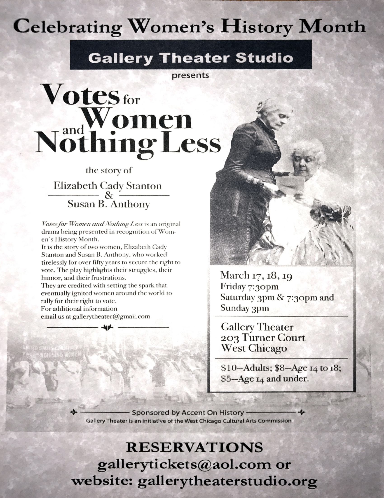

# Votes for Women and Nothing Less

*Originally published 2017-02-20 on caroltownsend.com*

Greetings fans!

I know you probably have many competing opportunities for celebrating Women's History Month, so lock this into your calendars early!  One weekend only, on March 17 - 19, Carol will be portraying Susan B. Anthony in **Votes for Women and Nothing Less**. Some die hard fans may be experiencing deja vu, and thinking this title sounds familiar.  You would be right!  Carol had a part in this same play back in 2011. This drama tells that tale of BFFs Elizabeth Cady Stanton and Susan B. Anthony (I love her dollars!), as they fight the power and work to bring women the right to vote.

 Tickets are $10 for Adults, $8 for Children ages 14-18, or $5 for Children 14 and under.

Performances are March 17, 18, and 19
Friday 7:30 pm, Saturday 3:00 pm and 7:30 pm, and Sunday 3:00 pm.

Gallery Theater
203 Turner Ct.
West Chicago, IL 60185

For reservations, email [gallerytickets@aol.com](mailto:gallerytickets@aol.com) or visit [gallerytheaterstudio.org](http://gallerytheaterstudio.org).

---

## Comments (1)

*Reader comments, as captured from caroltownsend.com.*

**Ben Middleton** — *2023-07-21*

> Very thoughtful blog
